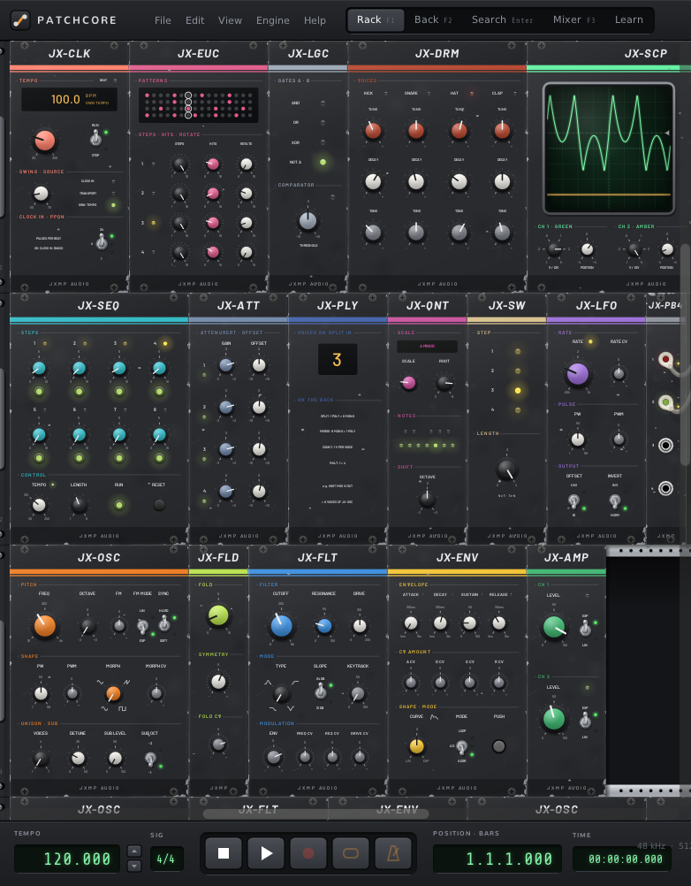
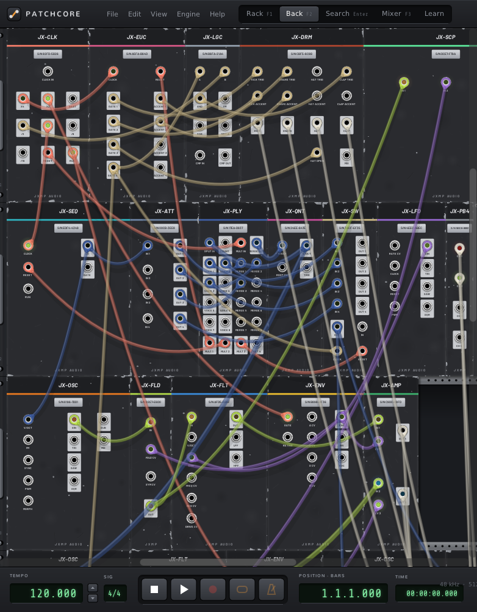
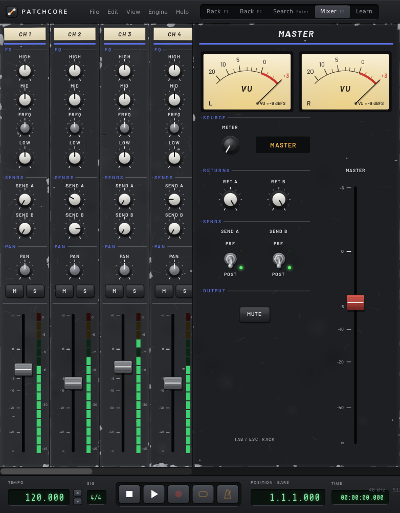

# PatchCore

PatchCore by JXMP Audio is a modular synthesizer that works like a real studio rack. Basic modules patch on
the front, our JXMP modules on the back: press `Tab` to turn the rack around, and a Patchbay links both sides.
It comes as a **standalone app** and as two **VST3 plugins**, **PatchCore** (instrument) and **PatchCore FX**
(effect), for Linux and Windows.

<p>



</p>

## Features

- A rack with a back side for the cables of the JXMP modules (`Tab`), Patchbay 4 / 8 / 16 between front and back
- 25+ JXMP modules: oscillator, filter, envelopes, LFO, sequencers, quantizer, clock, Euclidean rhythms, drums, a 16-slot sampler,
  scope, delay, chorus, reverb, wavefolder, ring modulator, logic, switch, poly tools and a mixing console with a
  Mixer view
- **Learn**: six interactive lessons that walk a beginner from the first sound to a song with drums and effects
- Quick search (right-click on the rack or `Enter`): `@jxmp` filters by brand, `#filter` by purpose
- Standalone: sound card settings in **Engine → Audio Settings…** (PipeWire/JACK or ALSA on Linux, WASAPI or ASIO
  on Windows), its own transport and a master meter
- VST3: a thin read-only bar with the host's tempo and position; MIDI goes through the Host MIDI modules

## Using it

| Key / mouse | Does |
|---|---|
| `Tab` | turn the rack around (front / back) |
| `F1` | the rack; with a selected module: its manual |
| `F2` / `F3` | the back / the Mixer view |
| `Enter`, right-click | find and add a module |
| `Space` | play / pause (standalone): a pause freezes everything where it is; Space twice quickly (or ■) stops and goes back to the start |
| Shift+click, Shift+drag | select / move a module; Shift+right-click opens its menu |
| Ctrl+drag | select an area |
| mouse wheel | turn knobs: Ctrl+wheel finely (1/10), Ctrl+Shift+wheel very finely, Shift+wheel coarsely; Ctrl+wheel elsewhere zooms the rack |

Without Shift, knobs and jacks always work, even on a selected module.

## JXMP modules

A manual page per module ([docs/manual/](docs/manual/)); in PatchCore select a module and press `F1`.

| Panel | Browser name | Manual |
|---|---|---|
| JX-OSC | VCO | [jx-osc](docs/manual/jx-osc.md) |
| JX-FLT | VCF | [jx-flt](docs/manual/jx-flt.md) |
| JX-LFO | LFO | [jx-lfo](docs/manual/jx-lfo.md) |
| JX-NSE | Noise | [jx-nse](docs/manual/jx-nse.md) |
| JX-MIX | Mixer | [jx-mix](docs/manual/jx-mix.md) |
| JX-SEQ | SEQ | [jx-seq](docs/manual/jx-seq.md) |
| JX-DLY | Delay | [jx-dly](docs/manual/jx-dly.md) |
| JX-QNT | Quantizer | [jx-qnt](docs/manual/jx-qnt.md) |
| JX-RND | Random | [jx-rnd](docs/manual/jx-rnd.md) |
| JX-SLW | Slew | [jx-slw](docs/manual/jx-slw.md) |
| JX-ATT | Attenuverter | [jx-att](docs/manual/jx-att.md) |
| JX-AMP | VCA | [jx-amp](docs/manual/jx-amp.md) |
| JX-ENV | ADSR | [jx-env](docs/manual/jx-env.md) |
| JX-CONSOLE | Console 4 / 8 / 16 / 32 | [jx-console](docs/manual/jx-console.md) |
| JX-SCP | Scope | [jx-scp](docs/manual/jx-scp.md) |
| JX-CLK | Clock | [jx-clk](docs/manual/jx-clk.md) |
| JX-EUC | Euclid | [jx-euc](docs/manual/jx-euc.md) |
| JX-SMPL | Sampler | [jx-smpl](docs/manual/jx-smpl.md) |
| JX-DRM | Drums | [jx-drm](docs/manual/jx-drm.md) |
| JX-REV | Reverb | [jx-rev](docs/manual/jx-rev.md) |
| JX-CHR | Chorus | [jx-chr](docs/manual/jx-chr.md) |
| JX-FLD | Folder | [jx-fld](docs/manual/jx-fld.md) |
| JX-RNG | Ring | [jx-rng](docs/manual/jx-rng.md) |
| JX-LGC | Logic | [jx-lgc](docs/manual/jx-lgc.md) |
| JX-SW | Switch | [jx-sw](docs/manual/jx-sw.md) |
| JX-PLY | Poly | [jx-ply](docs/manual/jx-ply.md) |
| JX-PB4 / PB8 / PB16 | Patchbay 4 / 8 / 16 | [jx-pb](docs/manual/jx-pb.md) |

## Building

Linux (in an environment with the usual audio/GL development packages):

```sh
git submodule update --init --recursive
make -j$(nproc) jack     # the standalone: bin/Cardinal
make -j$(nproc) vst3     # bin/CardinalSynth.vst3 (PatchCore), bin/CardinalFX.vst3 (PatchCore FX)
```

Windows builds are cross-compiled by the GitHub Actions workflow `patchcore` (Linux and Windows, started by hand).

## Licence and credits

PatchCore is free software under the GNU GPL version 3 or later ([LICENSE](LICENSE)). It is built on
[DISTRHO Cardinal](https://github.com/DISTRHO/Cardinal) (VCV Rack as a self-contained plugin) and
[DPF](https://github.com/DISTRHO/DPF), and includes the open-source modules that come with Cardinal, each under
its own licence. ASIO support uses Steinberg's ASIO SDK under its GPLv3 option. "VST" and "ASIO" are trademarks
of Steinberg Media Technologies GmbH.
