# JXMP modules — manual

One page per module. In PatchCore, right-click a module and choose **Info › User manual**: its page opens here.

Every page has the same parts: *What it does*, *How it works* (with a signal-flow picture), *Quick start*, the
*Front panel* and *Back panel* tables, *Everything it can do*, *Patch ideas*, *Good to know* and *See also*.

**The rack has two sides.** JXMP modules have their knobs on the front and their sockets on the back: `Tab` turns the
rack (or `F1` front and `F2` back). Basic modules (Host MIDI, Host Audio, other plugins) have their sockets on the front;
a [patchbay](jx-pb.md) connects the two sides. `F3` opens the Mixer view of [JX-CONSOLE](jx-console.md), `F4` the
[Editor](jx-edit.md). All keys are in the top bar under **Shortcuts**.

**Learning.** **Learn** in the top bar holds interactive lessons in six categories: 1 Basics, 2 Sound synthesis,
3 Rhythm and sequences, 4 Effects and mix, 5 Editor and song, 6 Advanced. Each step says why, what to do, and what
just happened; PatchCore checks your patch as you go. **View → Language** switches the lessons to Czech (more of the UI will follow).

## Sound sources

| | Module | What it is |
|---|---|---|
| 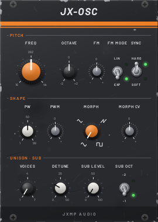 | [JX-OSC](jx-osc.md) · VCO | Oscillator: four shapes, morph, sub, unison up to 7 voices. |
| 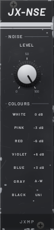 | [JX-NSE](jx-nse.md) · Noise | Seven colours of noise. |
| 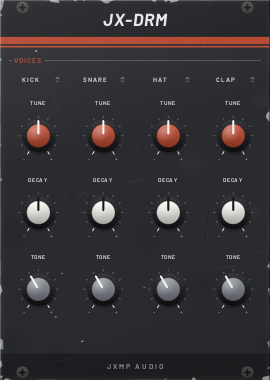 | [JX-DRM](jx-drm.md) · Drums | Kick, snare, hi-hat, clap. |
| 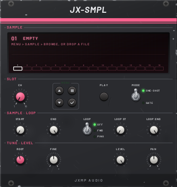 | [JX-SMPL](jx-smpl.md) · Sampler | 16 sample slots with editing, loops, envelopes and recording. |
| 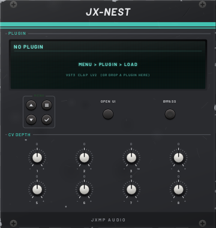 | [JX-NEST](jx-nest.md) · Plugin host | A VST3 / CLAP / LV2 plugin inside the patch. |

## Filters and shapers

| | Module | What it is |
|---|---|---|
| 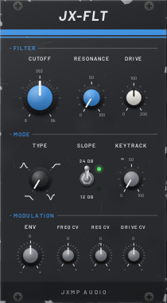 | [JX-FLT](jx-flt.md) · VCF | Ladder filter: LP, BP, HP, notch, 12 / 24 dB. |
| 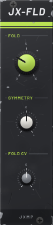 | [JX-FLD](jx-fld.md) · Folder | Wavefolder. |
| 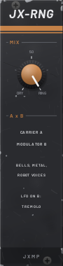 | [JX-RNG](jx-rng.md) · Ring | Ring modulator. |

## Envelopes and modulation

| | Module | What it is |
|---|---|---|
| 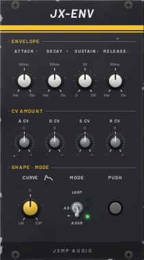 | [JX-ENV](jx-env.md) · ADSR | Envelope with ADSR, AD and LOOP modes. |
| 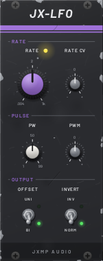 | [JX-LFO](jx-lfo.md) · LFO | Low-frequency oscillator with clock sync. |
| 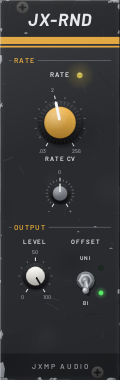 | [JX-RND](jx-rnd.md) · Random | Stepped and smooth random, sample & hold. |
| 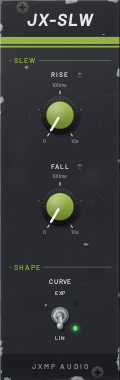 | [JX-SLW](jx-slw.md) · Slew | Glide and slew limiter. |

## Sequencing and time

| | Module | What it is |
|---|---|---|
| 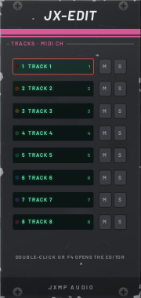 | [JX-EDIT](jx-edit.md) · Editor | Piano roll for whole songs (F4). |
| 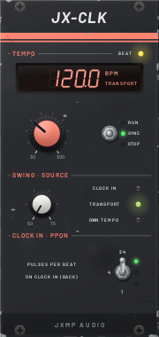 | [JX-CLK](jx-clk.md) · Clock | Master clock with divisions and swing. |
| 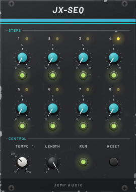 | [JX-SEQ](jx-seq.md) · SEQ | Eight-step sequencer. |
| 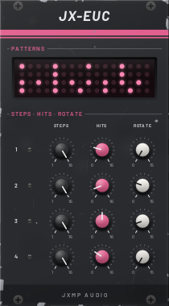 | [JX-EUC](jx-euc.md) · Euclid | Four Euclidean rhythm tracks. |
| 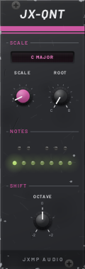 | [JX-QNT](jx-qnt.md) · Quantizer | Pitch to the nearest note of a scale. |

## Effects

| | Module | What it is |
|---|---|---|
| 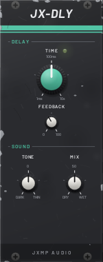 | [JX-DLY](jx-dly.md) · Delay | Mono delay up to 10 s. |
| 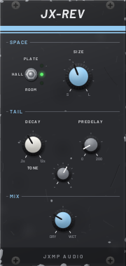 | [JX-REV](jx-rev.md) · Reverb | Stereo reverb: plate, hall, room. |
| 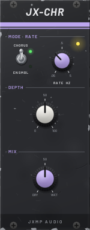 | [JX-CHR](jx-chr.md) · Chorus | Stereo chorus and ensemble. |

## Mixing and routing

| | Module | What it is |
|---|---|---|
| 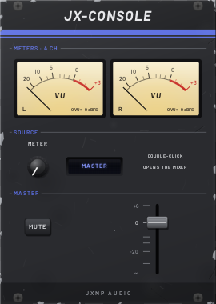 | [JX-CONSOLE](jx-console.md) · Console 4–32 | The song mixer with EQ, sends and the Mixer view (F3). |
| 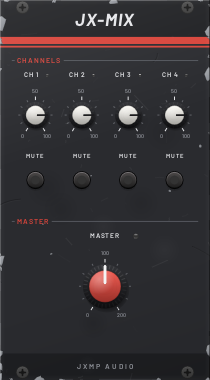 | [JX-MIX](jx-mix.md) · Mixer | Four-channel utility mixer. |
| 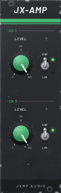 | [JX-AMP](jx-amp.md) · VCA | Two VCAs. |
| 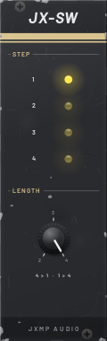 | [JX-SW](jx-sw.md) · Switch | Sequential switch 4 → 1 and 1 → 4. |
| 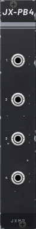 | [JX-PB4 / 8 / 16](jx-pb.md) · Patchbay | Front ↔ back connections. |

## Utilities

| | Module | What it is |
|---|---|---|
| 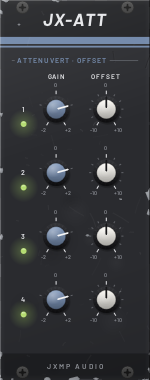 | [JX-ATT](jx-att.md) · Attenuverter | Gain and offset, manual voltages. |
| 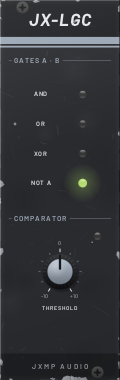 | [JX-LGC](jx-lgc.md) · Logic | AND, OR, XOR, NOT and a comparator. |
| 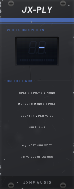 | [JX-PLY](jx-ply.md) · Poly | Split, merge, count voices, mult. |
| 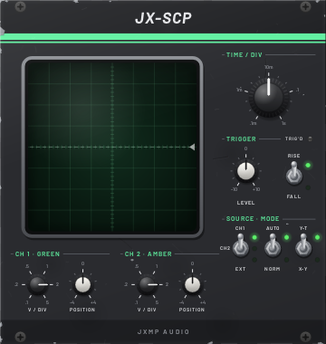 | [JX-SCP](jx-scp.md) · Scope | Two-channel oscilloscope. |

## A first voice

The smallest patch that plays notes from a keyboard or the Editor:

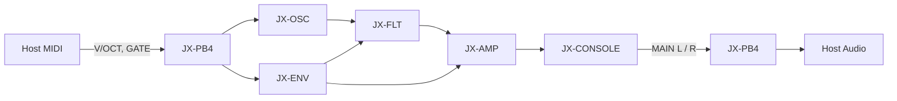

The [Cardinal modules](../CARDINAL-MODULES.md) page describes Host MIDI, Host Audio and the other basic modules.
