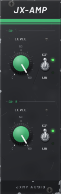
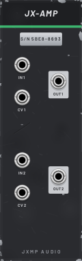

# JX-AMP — VCA

8 HP · JXMP Audio · [all modules](README.md)

Two VCAs with a level knob and linear or exponential response. Channel 2 is normalled to channel 1's input. Polyphonic.

 

## Front panel

| Control | What it does |
|---|---|
| LEVEL (CH 1, CH 2) | Channel level; with CV patched it is the maximum the CV can open to. |
| EXP / LIN | Response to the CV: EXP sounds natural for audio, LIN is exact for CV. |

## Sockets (back, `Tab` turns the rack)

| Socket | What it does |
|---|---|
| IN 1 | Signal to amplify (audio or CV). Polyphonic. |
| CV 1 | Level CV: 0 V closed, 10 V open (times LEVEL). |
| IN 2 | Signal for channel 2; unpatched, it takes IN 1. |
| CV 2 | Level CV for channel 2. |
| OUT 1, OUT 2 | IN × LEVEL × CV. |

## How to use it

- Every voice: JX-FLT OUT → IN 1, JX-ENV ENV → CV 1, OUT 1 → console.
- One sound, two envelopes: IN 2 unpatched, a second envelope into CV 2: two differently shaped copies.
- Without a CV the VCA is a plain volume knob.
