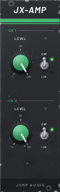
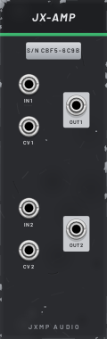
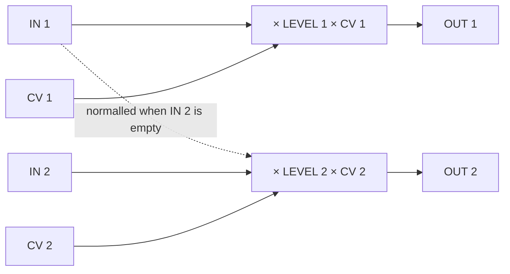

# JX-AMP — VCA

Two voltage-controlled amplifiers with a level knob and linear or exponential response.

8 HP · Mixing / routing · Polyphonic · [all modules](README.md)

 

## What it does

A VCA lets a CV set how loud a signal is. With an envelope on its CV, a sound starts and stops with each note; with
an LFO it pulses (tremolo). It works on audio and on CV alike, so it also scales modulation.

## How it works

- OUT = IN × LEVEL × CV, where 0 V on CV is closed and 10 V fully open.
- Without a CV cable the channel is a plain volume knob (LEVEL).
- IN 2 takes IN 1 when nothing is plugged into it: one signal through two differently shaped VCAs.
- EXP response sounds natural on audio; LIN is exact for CV.
- The light next to each channel shows its output level.

## Quick start

1. [JX-FLT](jx-flt.md) OUT → **IN 1**.
2. [JX-ENV](jx-env.md) ENV → **CV 1**.
3. **OUT 1** → [JX-CONSOLE](jx-console.md). Each note now has its own loudness shape.

## Front panel

| Control | Range | What it does |
|---|---|---|
| LEVEL (CH 1, CH 2) | 0 … 100 % (100) | Channel level; with a CV patched, the most the CV can open to. |
| EXP / LIN (each channel) | EXP default | Response to the CV. |

## Back panel (sockets)

`Tab` or `F2` turns the rack round.

| Socket | Signal | What it does |
|---|---|---|
| IN 1 | Audio / CV, poly | Signal for channel 1. |
| CV 1 | CV 0–10 V | Level of channel 1. |
| IN 2 | Audio / CV, poly | Signal for channel 2; empty = IN 1. |
| CV 2 | CV 0–10 V | Level of channel 2. |
| OUT 1, OUT 2 | Same as IN | IN × LEVEL × CV. |

## Everything it can do

- Two independent VCAs in 8 HP, polyphonic (the CV can be poly too: one envelope per voice).
- Normalled IN 2 for parallel processing of one source.
- Linear or exponential law per channel.
- Works as an attenuator for CV (an LFO into IN, LEVEL sets the depth).

## Patch ideas

- **Every voice:** filter → IN 1, envelope → CV 1, OUT 1 → console.
- **Tremolo:** a [JX-LFO](jx-lfo.md) in UNI mode into CV.
- **Two shapes of one sound:** IN 2 empty, a slow envelope on CV 2 into a reverb send, a short one on CV 1 dry.
- **Modulation depth by hand:** an LFO into IN 2, LEVEL 2 as the depth knob, OUT 2 into a CV input.

## Good to know

- A negative CV is treated as closed.
- A poly CV with fewer channels than IN is spread as Rack does: a mono CV controls every channel at once.

## See also

[JX-ENV](jx-env.md) · [JX-MIX](jx-mix.md) · [JX-CONSOLE](jx-console.md) · [JX-ATT](jx-att.md)
