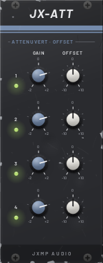
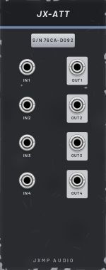
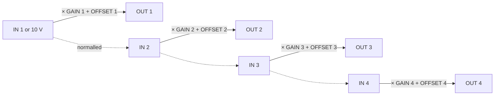

# JX-ATT — Attenuverter

Four rows of gain (−2× … +2×) and offset (±10 V); empty inputs chain from the row above, so empty rows are manual
voltage sources.

10 HP · Utility · Polyphonic · [all modules](README.md)

 

## What it does

JX-ATT makes a voltage bigger, smaller, upside down or shifted. It is the glue of modulation: tame an LFO that is too
strong, turn a 0–10 V envelope into ±5 V, or make a fixed voltage to transpose something.

## How it works

- OUT = IN × GAIN + OFFSET, limited to ±12 V.
- An empty IN takes the row above; an empty IN 1 is 10 V, so with nothing patched each row is a manual voltage.
- The LED of each row shows the polarity of its output.

## Quick start

1. A [JX-LFO](jx-lfo.md) SIN into **IN 1**, **OUT 1** → [JX-OSC](jx-osc.md) FM.
2. GAIN 1 at about 0.05: a gentle vibrato instead of a siren.

## Front panel

| Control | Range | What it does |
|---|---|---|
| GAIN 1–4 | −2× … +2× (1×) | Multiplies the input; negative inverts it. |
| OFFSET 1–4 | −10 … +10 V (0) | Adds a voltage. |

## Back panel (sockets)

`Tab` or `F2` turns the rack round.

| Socket | Signal | What it does |
|---|---|---|
| IN 1–4 | Any, poly | Row inputs; empty = the row above (row 1: 10 V). |
| OUT 1–4 | Same as IN | IN × GAIN + OFFSET, ±12 V at most. |

## Everything it can do

- Attenuate, amplify (up to 2×), invert and offset in one knob pair.
- Chained inputs: one source, four differently scaled copies.
- Manual voltage sources without any cable.

## Patch ideas

- **0–10 V → ±5 V:** GAIN 1, OFFSET −5 V.
- **Transpose:** nothing patched, GAIN 0, OFFSET +1 V into [JX-QNT](jx-qnt.md) ROOT CV (one octave up), or 1/12 V
  steps for semitones.
- **Inverted copy for a crossfade:** row 1 the LFO, row 2 empty (takes it) with GAIN −1, OFFSET +10 V.
- **Smaller sequencer range:** [JX-SEQ](jx-seq.md) CV with GAIN 0.2: the knobs span two octaves.

## See also

[JX-MIX](jx-mix.md) · [JX-AMP](jx-amp.md) · [JX-LFO](jx-lfo.md)
