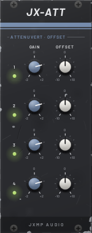
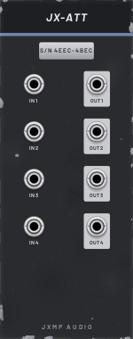

# JX-ATT — Attenuverter

10 HP · JXMP Audio · [all modules](README.md)

Four rows of gain (±2×) and offset (±10 V). An unpatched input takes the row above; the first row then gives a 10 V constant, so empty rows are manual voltage sources. Polyphonic.

 

## Front panel

| Control | What it does |
|---|---|
| GAIN 1–4 | Multiplies the input, −2× to +2× (negative inverts). The LED shows the polarity of the output. |
| OFFSET 1–4 | Adds −10 to +10 V. |

## Sockets (back, `Tab` turns the rack)

| Socket | What it does |
|---|---|
| IN 1–4 | Row inputs; unpatched, the row above (row 1: 10 V). |
| OUT 1–4 | IN × GAIN + OFFSET, limited to ±12 V. |

## How to use it

- Scale a modulation down: an LFO into IN, GAIN 0.1 gives gentle vibrato.
- Manual voltage: nothing patched, GAIN 0, OFFSET sets a fixed voltage (e.g. a transpose for JX-QNT ROOT CV).
- Turn 0–10 V into ±5 V: GAIN 1, OFFSET −5 V.
