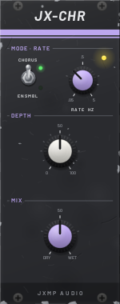
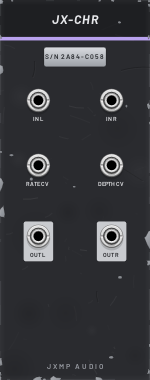
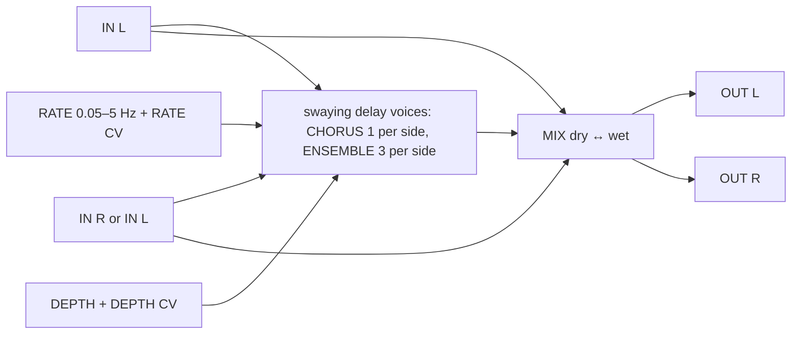

# JX-CHR — Chorus

A stereo chorus and ensemble: CHORUS is a gentle doubling, ENSEMBLE the lush string-machine sound.

10 HP · Effect · Stereo · [all modules](README.md)

 

## What it does

A chorus mixes the sound with slightly delayed copies whose delay sways slowly, so it sounds like several players at
once and spreads into stereo. ENSEMBLE uses more copies with a little vibrato, the sound of 70s string machines.

## How it works

- The right side sways against the left, which makes the stereo width.
- Switching the mode glides without a click. The light blinks at RATE.

## Quick start

1. A pad into **IN L**, **OUT L / OUT R** to two console channels panned left and right.
2. CHORUS, RATE 0.5 Hz, DEPTH 50 %, MIX 50 %.

## Front panel

| Control | Range | What it does |
|---|---|---|
| CHORUS / ENSMBL | CHORUS default | The mode. |
| RATE (HZ) | 0.05 … 5 Hz | How fast the voices sway. |
| DEPTH | 0 … 100 % (50) | How far they sway. |
| MIX | 0 … 100 % (50) | Dry to wet; 50 % is the classic chorus. |

## Back panel (sockets)

`Tab` or `F2` turns the rack round.

| Socket | Signal | What it does |
|---|---|---|
| IN L | Audio | Left (or mono) input. |
| IN R | Audio | Right input; empty = IN L. |
| RATE CV | CV | Adds to RATE, 1 V per 10 % of the knob. |
| DEPTH CV | CV 0–10 V | Adds to DEPTH. |
| OUT L, OUT R | Audio | Dry and chorus mixed by MIX. |

## Everything it can do

- Two modes, mono or stereo in, always stereo out.
- CV on rate and depth.

## Patch ideas

- **String machine:** a saw pad ([JX-OSC](jx-osc.md) VOICES 1) into IN L, ENSMBL, RATE 0.5 Hz, DEPTH 60 %.
- **Stereo from mono:** a mono synth into IN L, OUT L / R into two console channels panned apart.
- **Before the reverb:** JX-CHR → [JX-REV](jx-rev.md) for wide pads.

## See also

[JX-REV](jx-rev.md) · [JX-DLY](jx-dly.md) · [JX-OSC](jx-osc.md)
