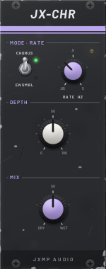
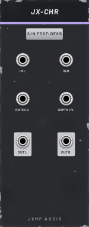

# JX-CHR — Chorus

10 HP · JXMP Audio · [all modules](README.md)

Stereo chorus and ensemble. CHORUS is a gentle doubling, one voice per side; ENSEMBLE uses three voices per side with a little vibrato, the lush string-machine sound.

 

## Front panel

| Control | What it does |
|---|---|
| CHORUS / ENSMBL | The mode (switching glides, no click). |
| RATE  HZ | How fast the voices sway, 0.05–5 Hz. |
| DEPTH | How far they sway. |
| MIX | Dry to wet; 50 % is the classic chorus. |

## Sockets (back, `Tab` turns the rack)

| Socket | What it does |
|---|---|
| IN L | Left (or mono) input. |
| IN R | Right input; unpatched, the left one is used. |
| RATE CV | Adds to RATE, 1 V per 10 % of the knob. |
| DEPTH CV | 0–10 V adds to DEPTH. |
| OUT L, OUT R | Dry and chorus mixed by MIX; the right side sways against the left. |

## How to use it

- String machine: a saw pad (JX-OSC VOICES 1) into IN L, ENSMBL, RATE 0.5 Hz, DEPTH 60 %.
- Stereo from mono: a mono synth into IN L, OUT L/R into two console channels panned left and right.
