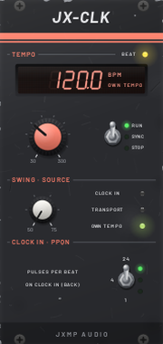
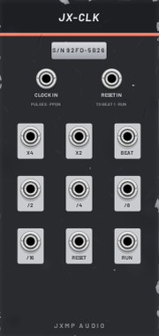

# JX-CLK — Clock

12 HP · JXMP Audio · [all modules](README.md)

Master clock of a patch. RUN: it runs on its own TEMPO and ignores the transport, so two clocks can run apart. SYNC: it follows the transport (the standalone's own, or the DAW's in a plugin) and stops with it. STOP: it stands. In RUN and SYNC, pulses on CLOCK IN lead if something is patched there. Seven divisions with swing, RESET and RUN outputs.

 

## Front panel

| Control | What it does |
|---|---|
| BPM window | The tempo in use, and STOPPED while the clock stands. |
| SOURCE LEDs | Which source runs the clock: CLOCK IN, TRANSPORT or OWN TEMPO. |
| TEMPO | Own tempo, 30–300 BPM, used when nothing else runs the clock. |
| RUN / SYNC / STOP | RUN: its own TEMPO (Space pauses it with everything else, a double Space does not restart it). SYNC: the transport's tempo and position, stopped when the transport stops. STOP: stands. Patches made before this switch open in SYNC. |
| BEAT | LED, blinks on every beat. |
| SWING | Delays every second x4 and x2 tick: 50 % straight, 66 % triplet feel, 75 % hard shuffle. |
| PPQN  24 / 4 / 1 | How many CLOCK IN pulses make one beat (Host MIDI's clock gives 24). |

## Sockets (back, `Tab` turns the rack)

| Socket | What it does |
|---|---|
| CLOCK IN | Clock pulses, e.g. the clock output of Host MIDI. |
| RESET IN | In RUN, a trigger sends the clock back to beat 1, keeping its own TEMPO, and fires its RESET output. Ignored in SYNC (the transport sets the position) and STOP. See *Two clocks* below. |
| x4, x2 | Sixteenths and eighths (swing applies), 10 V gates. |
| BEAT | Every beat. |
| /2, /4, /8, /16 | Every 2, 4 (a bar in 4/4), 8 and 16 beats. |
| RESET | A trigger when the clock starts: patch it to the RESET of sequencers. Patching this jack restarts the clock. |
| RUN | 10 V while the clock runs. |

## How to use it

- One JX-CLK drives everything: x4 → JX-EUC CLOCK, x2 → JX-SEQ CLOCK, RESET → both RESETs.
- In SYNC it follows the DAW's play and tempo (or the standalone transport) with nothing patched. New clocks start in RUN: switch to SYNC to lock to Cubase.
- Tempo-synced LFO: BEAT or /4 into JX-LFO CLOCK.

## Two clocks: RESET IN

A second JX-CLK in RUN runs on its own tempo, apart from the transport. RESET IN lines it up with the first one now
and then, while it keeps its own tempo: on a reset it jumps to beat 1, gives a fresh beat at once and fires its
RESET output, so the sequencers it drives start again with it.

- **Start together.** Clock A in SYNC (follows Cubase or the standalone transport), clock B in RUN at another tempo.
  A's RESET → B's RESET IN: on Play (and on a double Space) both start on the same beat, each at its own tempo.
- **A polyrhythm that comes back together.** A at 120 BPM, B at 160 BPM (four of B's beats against three of A's). A's /4 → B's RESET
  IN: the two drift apart during the bar and meet again on every downbeat of A. A's /16 instead: they meet every
  four bars, a longer phrase.
- **Restarting a phrase.** Any trigger works: a button, a step of JX-SEQ, JX-RND's random trigger. B starts its
  pattern again from beat 1 whenever it comes.

A reset in the middle of a beat cuts the gate that was high and starts a new one: no doubled beat.
