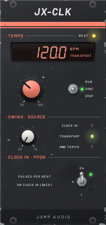
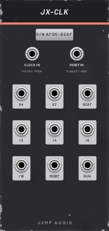
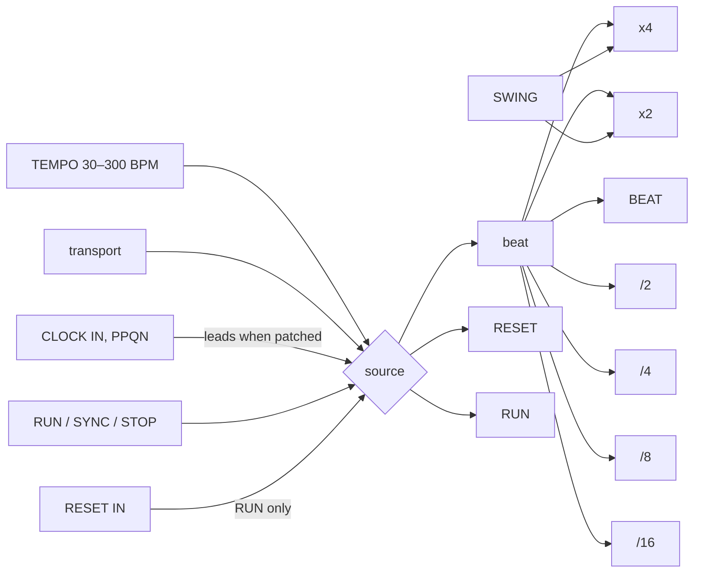

# JX-CLK — Clock

The master clock of a patch: its own tempo, the transport (standalone or DAW) or incoming clock pulses; seven
divisions with swing, RESET and RUN outputs.

12 HP · Sequencing / time · Mono · [all modules](README.md)

 

## What it does

Sequencers, drum patterns and tempo-synced LFOs all need a clock to move together. JX-CLK gives the beat and its
multiples and divisions, and starts everything in step. It can run on its own tempo, or follow PatchCore's transport
(Play / Space in the standalone, the DAW's play and tempo in a plugin).

## How it works

- **RUN:** its own TEMPO, whatever the transport does (a pause still freezes it).
- **SYNC:** follows the transport's tempo and position and stops with it.
- **STOP:** stands.
- In RUN and SYNC, pulses on CLOCK IN lead if something is patched there; PPQN says how many make one beat.
- The window shows the tempo in use (STOPPED while it stands); the SOURCE LEDs show what runs it.

## Quick start

1. **x4** → [JX-EUC](jx-euc.md) CLOCK, **RESET** → JX-EUC RESET.
2. Mode **SYNC**, press Play (Space): the pattern runs at the transport's tempo and starts on beat 1.

## Front panel

| Control | Range | What it does |
|---|---|---|
| BPM window | display | The tempo in use, STOPPED while it stands. |
| SOURCE LEDs | CLOCK IN, TRANSPORT, OWN TEMPO | Which source runs the clock. |
| TEMPO | 30 … 300 BPM (120) | Own tempo, used in RUN. |
| RUN / SYNC / STOP | RUN default | See above. Patches made before this switch open in SYNC. |
| BEAT | light | Blinks on every beat. |
| SWING | 50 … 75 % (50) | Delays every second x4 and x2 tick: 50 % straight, 66 % triplet feel, 75 % hard shuffle. |
| PPQN (24 / 4 / 1) | 24 default | Pulses per beat on CLOCK IN (Host MIDI's clock gives 24). |

## Back panel (sockets)

`Tab` or `F2` turns the rack round.

| Socket | Signal | What it does |
|---|---|---|
| CLOCK IN | Clock | External clock pulses, e.g. Host MIDI CLOCK. |
| RESET IN | Trigger | In RUN, back to beat 1 keeping its own TEMPO (and fires RESET). Ignored in SYNC and STOP. |
| x4, x2 | Gate 10 V | Sixteenths and eighths (with swing). |
| BEAT | Gate 10 V | Every beat. |
| /2, /4, /8, /16 | Gate 10 V | Every 2, 4 (a bar in 4/4), 8, 16 beats. |
| RESET | Trigger | When the clock starts; patching this jack restarts the clock so everything starts in step. |
| RUN | Gate 10 V | High while the clock runs. |

## Everything it can do

- Three sources (own tempo, transport, external pulses) and three modes.
- Seven outputs from sixteenths to four bars, swing on the fast ones.
- A RESET out so sequencers start on beat 1, a RUN gate for start / stop.
- Several clocks at different tempos that line up through RESET IN (see below).

## Patch ideas

- **One clock for everything:** x4 → JX-EUC, x2 → [JX-SEQ](jx-seq.md), RESET → both RESETs.
- **Follow Cubase:** SYNC with nothing patched: the DAW's play and tempo drive it.
- **Tempo-synced LFO:** BEAT or /4 into [JX-LFO](jx-lfo.md) CLOCK.
- **Shuffle:** SWING 60–66 % on x4 for a hip-hop groove.

## Two clocks: RESET IN

A second JX-CLK in RUN runs on its own tempo, apart from the transport. RESET IN lines it up with the first one now
and then while it keeps its own tempo: on a reset it jumps to beat 1, gives a fresh beat at once and fires its RESET
output, so the sequencers it drives start again with it.

- **Start together.** Clock A in SYNC, clock B in RUN at another tempo. A's RESET → B's RESET IN: on Play both start
  on the same beat, each at its own tempo.
- **A polyrhythm that comes back together.** A at 120 BPM, B at 160 BPM. A's /4 → B's RESET IN: they drift apart
  during the bar and meet on every downbeat of A; A's /16 instead: every four bars.
- **Restarting a phrase.** Any trigger works: a button, a step of JX-SEQ, [JX-RND](jx-rnd.md)'s trigger.

A reset in the middle of a beat cuts the gate that was high and starts a new one: no doubled beat.

## Good to know

- New clocks start in RUN; switch to SYNC to lock to the transport or a DAW.
- Space (pause) freezes every clock, also in RUN; a double Space stops the transport and goes back to the start.

## See also

[JX-SEQ](jx-seq.md) · [JX-EUC](jx-euc.md) · [JX-LFO](jx-lfo.md) · [JX-EDIT](jx-edit.md)
