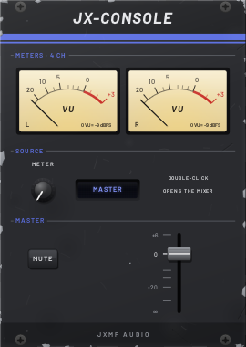
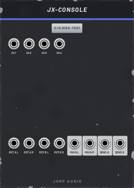
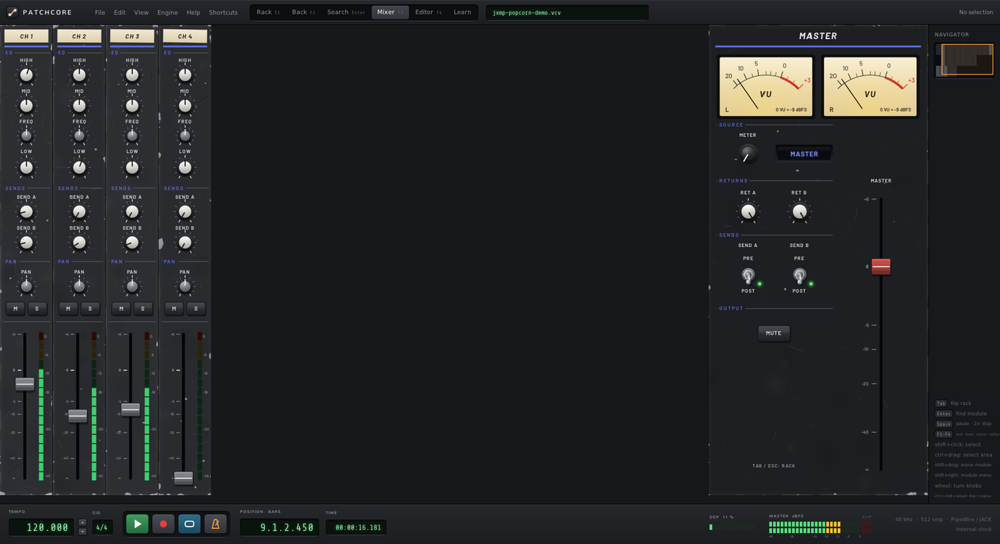
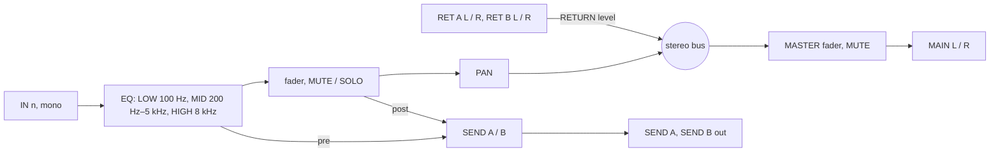

# JX-CONSOLE — Console 4 / 8 / 16 / 32

The project's main mixer with 4, 8, 16 or 32 channels: EQ, two sends, pan, mute, solo and fader per channel in the
Mixer view, VU meters and the master on the panel.

18 HP · Mixing / routing · Stereo out · [all modules](README.md)

 

## What it does

Every voice of a song ends in a console channel. There you balance the levels, place each sound left or right, shape
it with EQ and send it to shared effects (one reverb, one delay for everything). The result leaves on MAIN L / R to
the audio output.

*The Mixer view (F3): channel strips on the left, the master with VU meters, returns and send settings on the right.*

## How it works

- Each channel is mono in: a polyphonic cable is summed. Pan is constant power.
- The sends are mono and pre- or post-fader (one switch per send for all channels).
- The returns come back in stereo; an empty right side takes the left.
- Only one console works per project; a second one stays silent and says so.
- The front shows the meters and the master. Every channel control is in the Mixer view: double-click the console or
  press **F3** (Esc or F1 goes back to the rack).

## Quick start

1. Each voice's [JX-AMP](jx-amp.md) OUT → its own **IN** on the back.
2. **MAIN L / R** → a [JX-PB](jx-pb.md) → Host Audio on the front.
3. Press **F3** and set the faders while the song plays.

## Front panel

| Control | Range | What it does |
|---|---|---|
| VU meters | display | Two VU meters with real VU ballistics; the 0 VU point is set in the right-click menu. |
| METER SOURCE | master, channel 1–n | What the meters show (a channel post-fader). |
| MASTER mute | on / muted | Mutes MAIN L / R. |
| MASTER fader | −∞ … +6 dB (0 dB) | Master level. |

## Mixer view (F3)

| Per channel | Range | What it does |
|---|---|---|
| HIGH | ±15 dB | Shelf at 8 kHz. |
| MID, FREQ | ±15 dB, 200 Hz – 5 kHz | Bell at FREQ. |
| LOW | ±15 dB | Shelf at 100 Hz. |
| SEND A, SEND B | 0 … 100 % | Level into the sends. |
| PAN | left … right | Position in the stereo bus. |
| M, S | buttons | Mute, solo (muted-by-solo channels blink). |
| Fader | −∞ … +6 dB (0 dB) | Channel level, with a peak meter in dBFS. |

| Master side | What it does |
|---|---|
| RET A, RET B | Level of the returns. |
| SEND A / B PRE / POST | Sends taken before or after the faders. |
| METER, OUTPUT MUTE, MASTER | As on the panel. |

## Back panel (sockets)

`Tab` or `F2` turns the rack round.

| Socket | Signal | What it does |
|---|---|---|
| IN 1–n | Audio | Channel inputs, mono (poly is summed). |
| RET A L / R, RET B L / R | Audio | Stereo effect returns; an empty R takes L. |
| SEND A, SEND B | Audio | Mono effect sends. |
| MAIN L, MAIN R | Audio | Stereo master. |

## Right-click menu

| Item | What it does |
|---|---|
| VU meter reference | 0 VU = −9 dBFS (a 5 V sine, Rack level), −14 dBFS, or −18 dBFS (studio, EBU R68). |

## Everything it can do

- 4 to 32 channels with 3-band EQ, two sends, pan, mute, solo and fader each.
- Two stereo returns for shared effects.
- VU meters with selectable reference, peak meters per channel.
- A full-screen Mixer view that works while the song plays.

## Patch ideas

- **Shared reverb:** SEND B → [JX-REV](jx-rev.md) IN L, OUT L / R → RET B L / R, reverb MIX 100 %.
- **Shared echo:** SEND A → [JX-DLY](jx-dly.md) IN, WET → RET A L.
- **Drums apart:** each [JX-DRM](jx-drm.md) voice into its own channel, reverb only on snare and clap.
- **Levels:** keep the master around 0 VU and every channel peak below 0 dBFS.

## Good to know

- The Mixer view needs a console in the patch; F3 does nothing without one.
- The console is the place for the song mix; [JX-MIX](jx-mix.md) is for small sums inside a patch.

## See also

[JX-MIX](jx-mix.md) · [JX-REV](jx-rev.md) · [JX-DLY](jx-dly.md) · [JX-PB](jx-pb.md)
