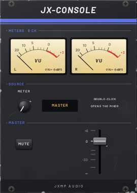
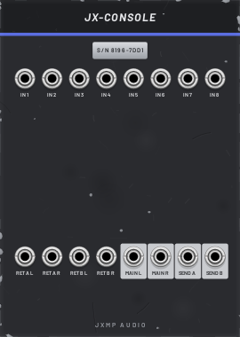

# JX-CONSOLE — Console 4 / 8 / 16 / 32

18 HP · JXMP Audio · [all modules](README.md)

The project's main mixer, with 4, 8, 16 or 32 channels. Only one console works per project; a second one stays silent and says so. The front shows the meters and the master; every channel control is in the Mixer view (double-click the console or press F3).

 

## Front panel

| Control | What it does |
|---|---|
| VU meters | Two VU meters with real VU ballistics. 0 VU = −9, −14 or −18 dBFS (module right-click menu, VU meter reference). |
| METER SOURCE | What the meters show: the master or one channel (post-fader). |
| MASTER mute | Mutes the master output. |
| MASTER fader | Master level, up to +6 dB. |
| Mixer view (F3) | Per channel: 3-band EQ (low shelf 100 Hz, mid 200 Hz – 5 kHz, high shelf 8 kHz, ±15 dB), SEND A and B, pan (constant power), mute, solo, fader to +6 dB, peak meter in dBFS. Global: send A/B pre- or post-fader, return A/B levels. |

## Sockets (back, `Tab` turns the rack)

| Socket | What it does |
|---|---|
| IN 1–n | Channel inputs, mono (a polyphonic cable is summed). |
| RET A L / R, RET B L / R | Stereo effect returns; an unpatched right side takes the left. Mixed into the master. |
| SEND A, SEND B | Mono effect sends: the channels × their SEND A / B (pre- or post-fader). |
| MAIN L, MAIN R | Stereo master: patch to the audio output (Audio / Host Audio). |

## How to use it

- Typical project: every voice's JX-AMP OUT → its own console channel, MAIN L/R → the audio output.
- Shared reverb: SEND A → JX-REV IN L, JX-REV OUT L/R → RET A L/R, JX-REV MIX at 100 %.
- Keep the master meter around 0 VU; the channel peak meters should stay below 0 dBFS.
