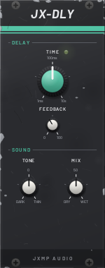
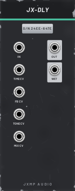
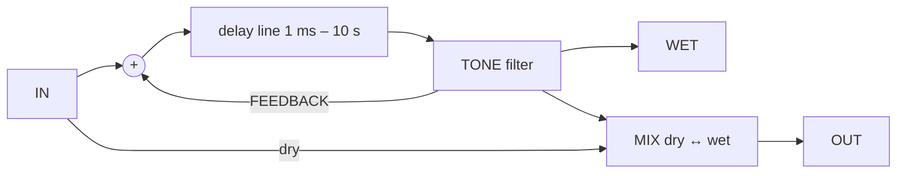

# JX-DLY — Delay

A mono delay from 1 ms to 10 s with feedback, a tone filter in the repeats and dry / wet mix; turning TIME glides like
tape.

10 HP · Effect · Mono (poly input summed) · [all modules](README.md)

 

## What it does

A delay repeats the sound after a set time: one short repeat thickens it (slapback), longer ones make echoes, and
feedback lets them fade out over many repeats. The tone filter makes each repeat darker or thinner, like old tape or
a telephone line.

## How it works

- The input is summed to mono. The repeats pass the TONE filter and go back into the line by FEEDBACK.
- Changing TIME (by hand or by CV) does not jump: the read point glides, so the pitch bends like tape.
- The LED blinks once per delay time.

## Quick start

1. A sound into **IN**, **OUT** to the console.
2. TIME at the middle (100 ms) up to about 3 o'clock for echoes, FEEDBACK 40 %, MIX 30 %.

## Front panel

| Control | Range | What it does |
|---|---|---|
| TIME | 1 ms – 10 s (100 ms in the middle) | Delay time. |
| FEEDBACK | 0 … 100 % (40) | How many repeats; near the top they go on a long time. |
| TONE | dark ← 0 → thin | Filter in the repeats: left lowpass (tape), right highpass (telephone). |
| MIX | dry ← → wet (50) | Balance on OUT. |

## Back panel (sockets)

`Tab` or `F2` turns the rack round.

| Socket | Signal | What it does |
|---|---|---|
| IN | Audio | Signal to delay (poly is summed to mono). |
| TIME CV | CV | 1 V moves TIME by a tenth of its range. |
| FB CV | CV | Feedback, 10 % per volt. |
| TONE CV | CV | Tone, 10 % per volt (negative darker). |
| MIX CV | CV | Mix, 10 % per volt. |
| OUT | Audio | Dry and delayed, mixed by MIX. |
| WET | Audio | Only the repeats, whatever MIX is set. |

## Everything it can do

- 1 ms to 10 s: from comb-filter and flanger-like short times to long ambient echoes.
- Tape-like glides when the time changes.
- A WET output for use as a send effect.
- CV over every knob.

## Patch ideas

- **Send effect:** [JX-CONSOLE](jx-console.md) SEND A → IN, WET → RETURN A; each channel's SEND A sets how much.
- **Slapback:** TIME ≈ 100 ms, FEEDBACK 10 %, MIX 30 %.
- **Dotted eighth at 120 BPM:** TIME 375 ms, FEEDBACK 35 %, TONE a little dark.
- **Tape wobble:** a slow [JX-LFO](jx-lfo.md) SIN into TIME CV through [JX-ATT](jx-att.md) at a tiny gain.
- **Karplus-ish pluck:** TIME 2–10 ms, FEEDBACK 90 %, a short noise burst into IN.

## Good to know

- The delay is mono; for stereo width put [JX-CHR](jx-chr.md) or [JX-REV](jx-rev.md) after it.
- There is no tempo sync: set the time in milliseconds (60 000 / BPM = a quarter note).

## See also

[JX-REV](jx-rev.md) · [JX-CHR](jx-chr.md) · [JX-CONSOLE](jx-console.md)
