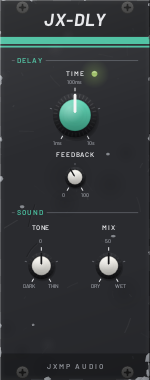
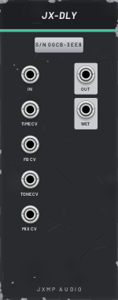

# JX-DLY — Delay

10 HP · JXMP Audio · [all modules](README.md)

Mono delay from 1 ms to 10 s with feedback, a tone filter in the repeats and dry/wet mix; turning TIME glides like tape.

 

## Front panel

| Control | What it does |
|---|---|
| TIME | Delay time, 1 ms – 10 s (100 ms in the middle). The LED blinks once per delay time. |
| FEEDBACK | How many repeats; near the top they go on for a long time. |
| TONE | Filter in the repeats: left darker (tape), right thinner (telephone). |
| MIX | Dry to wet. |

## Sockets (back, `Tab` turns the rack)

| Socket | What it does |
|---|---|
| IN | Audio to delay (polyphonic inputs are summed to mono). |
| TIME CV | 1 V moves TIME by a tenth of its range; changes bend the pitch like tape. |
| FB CV, TONE CV, MIX CV | 10 % per volt. |
| OUT | Dry and delayed, mixed by MIX. |
| WET | Only the repeats, whatever MIX is set. |

## How to use it

- As a console send: JX-CONSOLE SEND A → IN, WET → RETURN A.
- Slapback: TIME about 100 ms, FEEDBACK low, MIX 30 %.
- Tape wobble: a slow JX-LFO SIN into TIME CV with a tiny amount (use JX-ATT to scale it).
