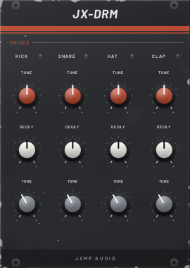
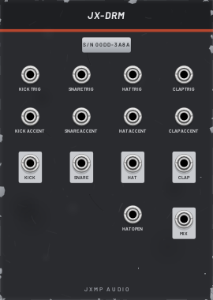
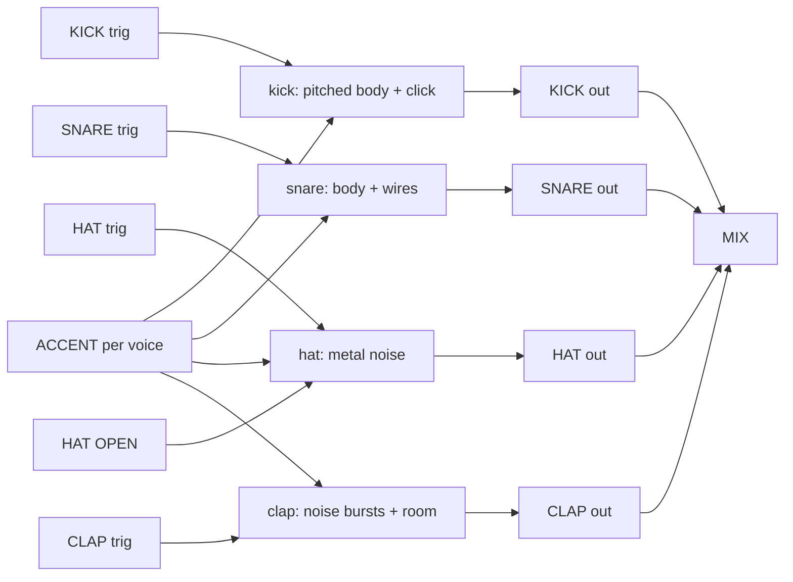

# JX-DRM — Drums

Four synthesized drum voices: kick, snare, hi-hat (closed and open with choke) and clap, with tune, decay and tone
each, accent inputs, an output per voice and a mix.

18 HP · Sound source · Mono · [all modules](README.md)

 

## What it does

JX-DRM is a small drum machine without its own sequencer: send it triggers from [JX-EUC](jx-euc.md), [JX-SEQ](jx-seq.md)
or the [Editor](jx-edit.md) and it plays the four classic electronic drums. Every voice is synthesized, so tune,
decay and tone change its character a lot.

## How it works

- A rising edge on a trigger plays the voice. An ACCENT that is high while the trigger comes makes the hit louder.
- HAT plays a closed hat and chokes an open one; HAT OPEN plays an open hat that rings for the HAT DECAY.
- Each voice has its own output (about ±5 V) and all four are summed on MIX.
- A LED per voice flashes on each hit.

## Quick start

1. [JX-CLK](jx-clk.md) x4 → JX-EUC CLOCK; JX-EUC GATE 1–4 → **KICK, SNARE, HAT, CLAP** trig.
2. **MIX** → a [JX-CONSOLE](jx-console.md) channel. Press Play.

## Front panel

| Control | Range | What it does |
|---|---|---|
| TUNE (per voice) | 0 … 100 % (50) | Kick: body pitch 35–90 Hz. Snare: drum body. Hat: the metal. Clap: the noise. |
| DECAY (per voice) | 0 … 100 % (50) | Kick boom, snare wires, the ring of an OPEN hat (closed hats stay short), clap room tail. |
| TONE (per voice) | 0 … 100 % (40) | Kick: rounder → harder (click, drive). Snare: body → wires. Hat: darker → brighter. Clap: wider → narrower. |
| Hit LEDs | lights | Flash on every hit. |

## Back panel (sockets)

`Tab` or `F2` turns the rack round.

| Socket | Signal | What it does |
|---|---|---|
| KICK, SNARE, HAT, CLAP trig | Trigger / gate | Plays the voice on a rising edge (HAT: closed, chokes an open one). |
| HAT OPEN | Trigger | Plays an open hat. |
| ACCENT (per voice) | Gate | High during the trigger: a louder hit. |
| KICK, SNARE, HAT, CLAP out | Audio ±5 V | Each voice alone (accented hits with long DECAY and high TONE reach about ±8 V). |
| MIX | Audio | All four together. |

## Everything it can do

- Four voices, each with its own output for separate EQ, effects and levels.
- Open / closed hat with choke, like a real hi-hat.
- Accents per voice.

## Patch ideas

- **Basic beat:** see Quick start; turn HITS on JX-EUC to change the groove.
- **From the Editor:** four Host MIDI modules on four channels, their GATE (through a [JX-PB](jx-pb.md)) into the
  triggers, VELOCITY into ACCENT; draw the drums in the piano roll.
- **Separate mix:** each voice into its own console channel, reverb send only on the snare and clap.
- **Off-beat open hat:** a JX-EUC track with 4 hits, ROTATE 2, into HAT OPEN; the closed hats on HAT choke it.
- **808-style long kick:** KICK TUNE low, DECAY high, TONE low.

## Good to know

- Triggers shorter than 1 ms are fine; a gate that stays high plays one hit (it needs to fall before the next).

## See also

[JX-EUC](jx-euc.md) · [JX-CLK](jx-clk.md) · [JX-CONSOLE](jx-console.md) · [JX-EDIT](jx-edit.md)
