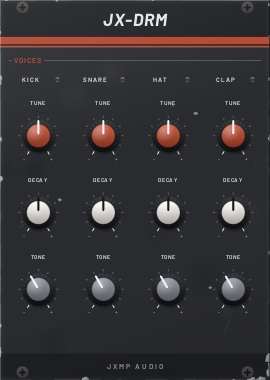
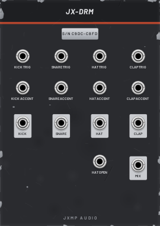

# JX-DRM — Drums

18 HP · JXMP Audio · [all modules](README.md)

Four drum voices: kick, snare, hi-hat (closed and open with choke) and clap. Tune, decay and tone per voice, trigger and accent inputs, an output per voice and a mix.

 

## Front panel

| Control | What it does |
|---|---|
| TUNE (KICK, SNARE, HAT, CLAP) | Kick: body pitch 35–90 Hz. Snare: drum body. Hat: the metal. Clap: the noise. |
| DECAY | Kick boom, snare wires, the ring of an OPEN hat (closed hats stay short), clap room tail. |
| TONE | Kick: rounder to harder (click and drive). Snare: body to wires. Hat: darker to brighter. Clap: wider to narrower. |
| Hit LEDs | Flash on every hit. |

## Sockets (back, `Tab` turns the rack)

| Socket | What it does |
|---|---|
| KICK, SNARE, HAT, CLAP trig | Plays the voice on a rising edge; HAT plays a closed hat and chokes an open one. |
| HAT OPEN | Plays an open hat that rings for the HAT DECAY. |
| ACCENT (per voice) | High while the trigger comes: that hit is louder. |
| KICK, SNARE, HAT, CLAP out | Each voice alone, about ±5 V. |
| MIX | All four together. |

## How to use it

- With JX-EUC (see there), or JX-SEQ GATE for a programmed pattern.
- Separate outputs into separate console channels to EQ and send them apart (e.g. reverb only on the snare).
- Open hat on the off-beat: a JX-EUC track with 4 hits, ROTATE 2, into HAT OPEN; closed hats on HAT choke it.
