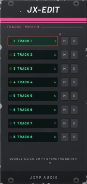
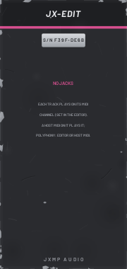
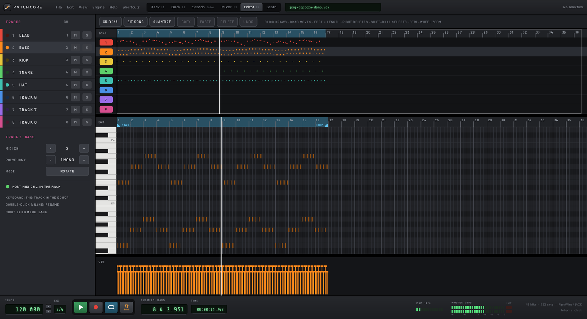
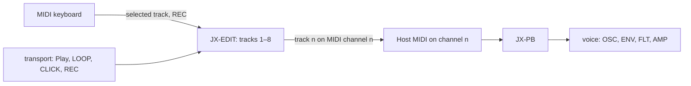

# JX-EDIT — Editor

A piano roll for whole songs: eight tracks of notes, each played on its own MIDI channel into the Host MIDI modules of
the patch.

12 HP · Editor · Standalone only · [all modules](README.md)

 

## What it does

JX-EDIT is where you write the music of a patch: draw notes with the mouse or record them from a MIDI keyboard, see the
whole song at once, loop a part and play it with the transport. Each of its eight tracks sends its notes on a MIDI
channel; a Host MIDI module set to that channel turns them into V/OCT, GATE and VELOCITY for a voice in the rack.

*The Editor (F4): the track list and track settings on the left, the song overview at the top, the piano roll with the
loop flags and the velocity lane below.*

## How it works

- The module in the rack holds the song and shows the eight tracks with M (mute) and S (solo). The editing happens in
  the Editor view: double-click the module or press **F4**.
- Every track plays on its MIDI channel (set with MIDI CH; several tracks may share one). A Host MIDI module whose
  input channel is that channel plays it; one on ALL plays every track.
- Polyphony and the voice mode (ROTATE, REUSE, RESET) are kept in step with that Host MIDI in both directions; an MPE
  Host MIDI is left as it is.
- Notes on one channel that touch get a 1 ms gap, so a mono voice starts its envelope again on every note.
- The song plays with PatchCore's transport (Space). LOOP repeats the part between the START and STOP flags; CLICK is a
  metronome; REC records the MIDI keyboard into the selected track while playing (one undo step per take).
- While the Editor is open (or REC is on) the keyboard plays the selected track's channel.
- Only one JX-EDIT works per project (a second one says SECOND EDITOR - INACTIVE). In a DAW (VST3) the DAW writes the
  notes, so the module says STANDALONE ONLY.

## Quick start

1. Add a Host MIDI, set its input channel to 1, and patch its V/OCT and GATE (through a [JX-PB](jx-pb.md)) to a voice.
2. Add JX-EDIT and press **F4**. Track 1 is on channel 1: the info on the left says HOST MIDI CH 1 IN THE RACK.
3. Click in the roll to draw notes, press Space: they play. Esc goes back to the rack.

## The module (rack)

| Part | What it does |
|---|---|
| TRACKS · MIDI CH | The eight tracks with their channel; click one to select it (the keyboard then plays it). |
| M, S | Mute and solo per track. |
| Double-click / F4 | Opens the Editor. |
| Back | No jacks: the notes go out through Host MIDI. The back says how. |

## The Editor (F4)

| Part | What it does |
|---|---|
| Track list | Name, channel, M / S; click selects, double-click a name renames it. |
| MIDI CH − / + | The track's MIDI channel 1–16. |
| POLYPHONY − / + | Voices of the Host MIDI on that channel (1 MONO … 16). |
| MODE | ROTATE, REUSE, RESET (click: next, right-click: back); MPE when the Host MIDI is in MPE. |
| Status lines | Whether a Host MIDI plays the track and what to do if not. |
| GRID | 1/4, 1/8, 1/16, 1/32, 1/8 T, 1/16 T or OFF. |
| FIT SONG | Zooms the roll to the whole song. |
| QUANTIZE | Moves the selected notes (or all) to the grid. |
| COPY, PASTE, DELETE, UNDO | On the selection; paste lands at the playhead (or the view start), repeated pastes follow each other. |
| SONG overview | All tracks over the song; click a row to pick the track, Ctrl+wheel changes how much it shows. |
| Ruler | Click: move the playhead. The lower half holds the START and STOP loop flags (at least 1/16 apart). |
| Piano roll | The notes of the selected track. |
| VEL | Velocity of each note: drag a bar up or down. |

## Keys and mouse

| Action | How |
|---|---|
| Draw a note (as long as the last one) | Click |
| Move notes / change the length | Drag / drag the end |
| Delete a note | Right-click |
| Add to the selection | Shift+click |
| Select with a box | Shift+drag |
| Select all / copy / paste | Ctrl+A / C / V |
| Delete the selected notes | Delete |
| Quantize | Q |
| Undo | Ctrl+Z |
| Choose a track | Click it (list / overview) |
| Previous / next track | PgUp / PgDn |
| Move the view (faster with Shift) | Arrows |
| Higher / lower notes | Wheel |
| Earlier / later | Shift+wheel |
| Zoom | Ctrl+wheel |
| Rename a track | Double-click its name |
| Back to the rack | Esc |

The same list is in the top bar under **Shortcuts**.

## Everything it can do

- Eight tracks over a whole song, each on any MIDI channel, mute and solo.
- Drawing with a grid (straight or triplet), moving, resizing, velocity, box selection, copy / paste, quantize, undo.
- A note sounds while you draw or drag it (only while paused or stopped).
- A new note is as long as the last one you drew or clicked.
- Loop with START / STOP flags, metronome, recording from a MIDI keyboard (also across the loop).
- Polyphony and voice mode synchronized with the Host MIDI modules.
- A song overview with track picking, FIT SONG, a column that scrolls in low windows.
- The song is saved in the patch.

## Patch ideas

- **Lead, bass and drums:** three Host MIDI modules on channels 1, 2 and 3–5; tracks 1–5 on those channels; drums
  through [JX-DRM](jx-drm.md) triggers (Host MIDI GATE) with VELOCITY on ACCENT.
- **Chords:** POLYPHONY 4 on a track, the Host MIDI's poly V/OCT into one polyphonic [JX-OSC](jx-osc.md).
- **Record a part:** select the track, turn LOOP on around 4 bars, REC and Space; play, then Q to tidy it up.
- **A plugin instrument:** a [JX-NEST](jx-nest.md) with the plugin, its MIDI channel set to the track's channel.

## Good to know

- Without a Host MIDI on its channel a track plays into nothing: the status lines on the left say so and how to add
  one.
- Tempo and time signature come from the transport in the bottom bar.

## See also

[JX-CLK](jx-clk.md) · [JX-SEQ](jx-seq.md) · [JX-DRM](jx-drm.md) · [JX-NEST](jx-nest.md) · [Cardinal modules](../CARDINAL-MODULES.md)
