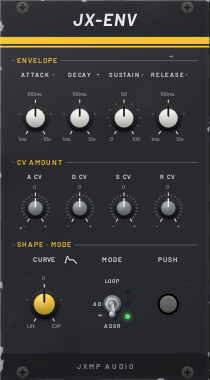
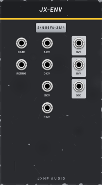
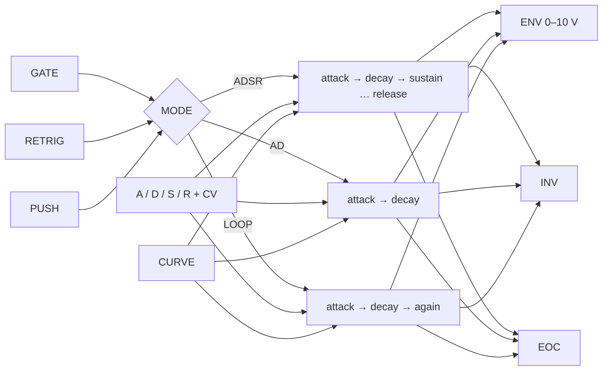

# JX-ENV — ADSR

An envelope generator with ADSR, AD and LOOP modes, a curve control, CV on every stage and three outputs.

14 HP · Envelope / modulation · Polyphonic · [all modules](README.md)

 

## What it does

JX-ENV turns a gate (a key held down) into a shape over time: it rises (attack), falls to a level (decay, sustain)
and fades when the key is let go (release). Patched into a VCA it shapes loudness, into a filter it shapes the tone.
In LOOP mode it repeats on its own like an LFO.

## How it works

- A stage time is 1 ms at the left, 100 ms in the middle and 10 s at the right of the knob.
- The gate counts as "on" above 1 V. Every channel of GATE runs its own envelope (polyphony).
- **ADSR:** attack and decay while the gate is high, holds SUSTAIN, releases when it falls.
- **AD:** attack then decay to zero, however long the gate is (drums, plucks).
- **LOOP:** attack and decay over and over; without a GATE cable it runs freely, with one it loops while the gate is
  high.
- CURVE bends the stages from linear to exponential (snappy start, long tail).
- The four lights show the stage that is running.

## Quick start

1. Host MIDI GATE (through a [JX-PB](jx-pb.md)) → **GATE**.
2. **ENV** → [JX-AMP](jx-amp.md) CV 1, the sound into JX-AMP IN 1.
3. Hold a key: the sound fades in by ATTACK and out by RELEASE. Press **PUSH** to try it without a keyboard.

## Front panel

| Control | Range | What it does |
|---|---|---|
| ATTACK | 1 ms – 10 s | Rise time. |
| DECAY | 1 ms – 10 s | Fall time to the sustain level. |
| SUSTAIN | 0 … 100 % | Level held while the gate is high (ADSR only). |
| RELEASE | 1 ms – 10 s | Fade after the gate falls. |
| CV AMOUNT A, D, S, R | −100 … +100 % | How much each CV socket moves its stage. |
| CURVE | −100 … +100 % | From linear to exponential stages. |
| MODE | ADSR, AD, LOOP | How the envelope runs (see above). |
| PUSH | button | Plays the envelope by hand while held. |

## Back panel (sockets)

`Tab` or `F2` turns the rack round.

| Socket | Signal | What it does |
|---|---|---|
| GATE | Gate, poly | The envelope runs while this is above 1 V. In LOOP, unpatched = free-running. |
| RETRIG | Trigger | Restarts the attack without waiting for the gate to fall. |
| A CV, D CV, S CV, R CV | CV | Stage CVs; 10 V = the full knob range, scaled by the CV AMOUNT knobs. |
| ENV | CV 0–10 V | The envelope. |
| INV | CV 10–0 V | 10 V minus the envelope: rests at 10 V, dips while a note plays. |
| EOC | Trigger | 1 ms at the end: end of release (ADSR), end of decay (AD), every cycle (LOOP). |

## Everything it can do

- Three modes in one module: note envelope, one-shot drum envelope, looping modulator.
- CV over every stage time and the sustain level.
- Inverted output for "ducking" (side-chain style dips).
- End-of-cycle trigger for chaining envelopes or triggering the next event.
- A push button for testing sounds without a keyboard or sequencer.

## Patch ideas

- **Pluck:** ATTACK 1 ms, DECAY 250 ms, SUSTAIN 0, RELEASE 150 ms.
- **Pad:** ATTACK 1 s, SUSTAIN 80 %, RELEASE 2 s.
- **Two-stage shape:** EOC of one JX-ENV into GATE of another.
- **Ducking:** a kick trigger into GATE (AD), INV into the CV of a pad's JX-AMP.
- **Velocity feel:** Host MIDI VELOCITY into S CV or D CV.
- **Rhythmic modulation:** LOOP mode, short times, ENV into [JX-FLT](jx-flt.md) ENV.

## Good to know

- Touching notes on one mono channel need a gap so the envelope starts again; the [Editor](jx-edit.md) leaves 1 ms
  between them. Use RETRIG for legato lines that should still retrigger.
- ENV never goes below 0 V, so it suits VCAs and filter amounts directly.

## See also

[JX-AMP](jx-amp.md) · [JX-FLT](jx-flt.md) · [JX-LFO](jx-lfo.md) · [JX-SLW](jx-slw.md)
