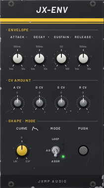
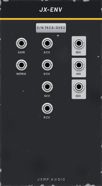

# JX-ENV — ADSR

14 HP · JXMP Audio · [all modules](README.md)

Envelope with CV for every stage, a curve control, ADSR / AD / LOOP modes, a push button and three outputs. Polyphonic: one envelope per channel of the gate cable.

 

## Front panel

| Control | What it does |
|---|---|
| ATTACK, DECAY, RELEASE | Stage times, 1 ms – 10 s (100 ms in the middle). |
| SUSTAIN | Level held while the gate is high, 0–100 %. |
| CV AMOUNT A, D, S, R | How much each CV socket moves its stage, ±100 %. |
| CURVE | From linear to exponential (snappy) stages. |
| MODE  ADSR / AD / LOOP | ADSR: the usual. AD: attack and decay, ignores how long the gate is (drums). LOOP: repeats attack–decay like an LFO. |
| PUSH | Plays the envelope by hand, for trying out a sound. |

## Sockets (back, `Tab` turns the rack)

| Socket | What it does |
|---|---|
| GATE | Runs while above 1 V. Polyphonic. In LOOP mode, unpatched = free-running. |
| RETRIG | Restarts the attack without waiting for the gate to close. |
| A CV, D CV, S CV, R CV | Stage CVs, 10 V = the full knob range. |
| ENV | 0–10 V: to JX-AMP CV or JX-FLT ENV. |
| INV | 10 V minus the envelope (rests at 10 V, dips while a note plays). |
| EOC | A 1 ms trigger at the end (end of release, end of decay in AD, every cycle in LOOP). |

## How to use it

- Pluck: ATTACK 1 ms, DECAY 300 ms, SUSTAIN 0–20 %, RELEASE 200 ms.
- Pad: ATTACK 1 s, SUSTAIN 80 %, RELEASE 2 s.
- Chain: EOC of one envelope into GATE of another for two-part shapes.
- Velocity-like accents: an accent CV into S CV or D CV.
