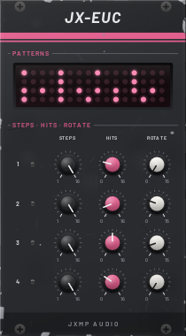
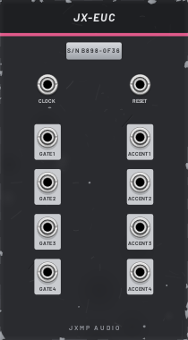
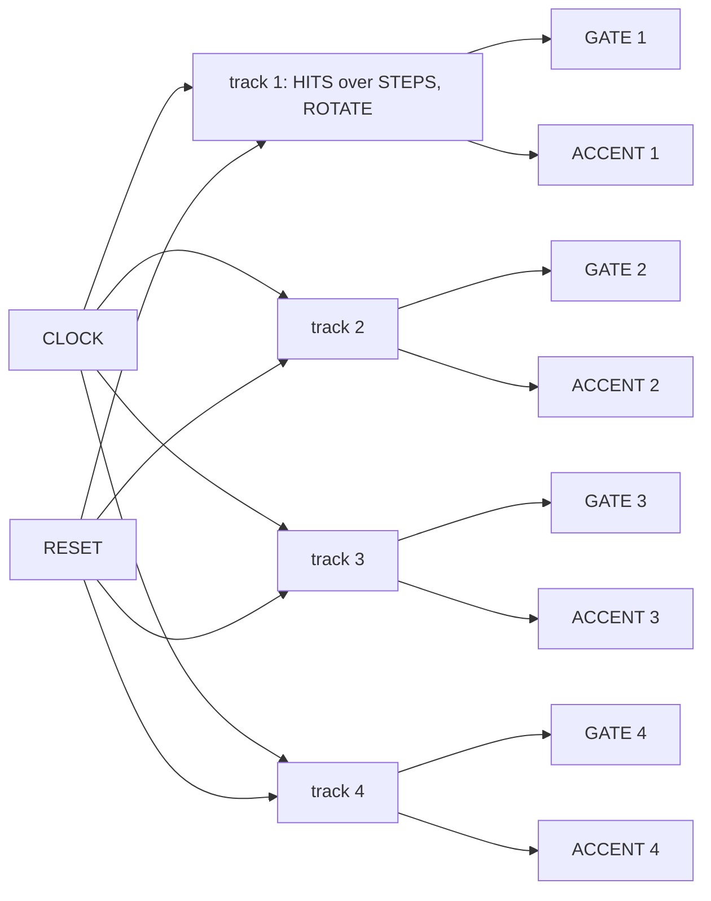

# JX-EUC — Euclid

Four Euclidean rhythm tracks: the hits are spread as evenly as possible over the steps, with gate and accent outputs.

14 HP · Sequencing / time · Mono · [all modules](README.md)

 

## What it does

JX-EUC is a quick drum programmer: say how many steps a pattern has and how many hits it should contain, and it spreads
them as evenly as possible. Many rhythms of the world come out this way (3 in 8 is a tresillo, 5 in 8 a cinquillo).
It starts with a ready beat: four on the floor, a backbeat, eighths and a five-hit figure.

## How it works

- Every clock edge moves all four tracks one step; each track wraps at its own STEPS.
- GATE is high while the clock is high on a hit; ACCENT does the same only on the first hit of the pattern.
- ROTATE moves the pattern later by whole steps.
- The display shows the four patterns and the playing step; a LED per track flashes on each hit.

## Quick start

1. [JX-CLK](jx-clk.md) x4 → **CLOCK**, JX-CLK RESET → **RESET**.
2. GATE 1–4 → [JX-DRM](jx-drm.md) KICK, SNARE, HAT, CLAP trig; ACCENT 1–4 → the accent inputs.
3. Press Play: a beat. Turn HITS and ROTATE to change it.

## Front panel

| Control | Range | What it does |
|---|---|---|
| PATTERNS | display | The four patterns and the playing step. |
| STEPS 1–4 | 1 … 16 | Pattern length in clock steps. |
| HITS 1–4 | 0 … 16 | How many hits are spread over the steps. |
| ROTATE 1–4 | 0 … 15 | Moves the pattern later by this many steps. |

## Back panel (sockets)

`Tab` or `F2` turns the rack round.

| Socket | Signal | What it does |
|---|---|---|
| CLOCK | Clock | Every rising edge moves all tracks one step. |
| RESET | Trigger | Back to the start; the next clock plays step 1. |
| GATE 1–4 | Gate | High while the clock is high on a hit. |
| ACCENT 1–4 | Gate | Like GATE, only on the first hit of the pattern. |

## Everything it can do

- Four independent patterns from one clock, each with its own length (polyrhythms).
- Accents on the downbeat of each pattern.
- Any track can drive more than drums: envelopes, sample & hold, sequencer clocks.

## Patch ideas

- **Drum machine:** as in Quick start.
- **Polyrhythm:** STEPS 16, 12, 7, 5 on the four tracks.
- **Melody rhythm:** a GATE into [JX-ENV](jx-env.md) GATE and [JX-RND](jx-rnd.md) CLOCK, STEP → [JX-QNT](jx-qnt.md).
- **Clocking a sequencer unevenly:** a GATE into [JX-SEQ](jx-seq.md) CLOCK: the melody moves on the hits only.

## See also

[JX-DRM](jx-drm.md) · [JX-CLK](jx-clk.md) · [JX-SEQ](jx-seq.md)
