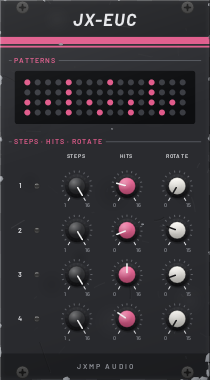
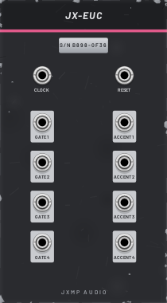

# JX-EUC — Euclid

14 HP · JXMP Audio · [all modules](README.md)

Four Euclidean rhythm tracks: the hits are spread as evenly as possible over the steps. Gate and accent outputs per track and a pattern display. Starts with a ready beat (four on the floor, backbeat, eighths, a five-hit figure).

 

## Front panel

| Control | What it does |
|---|---|
| PATTERNS | Display of the four patterns and the playing step; a LED per track flashes on every hit. |
| STEPS 1–4 | Pattern length, 1–16 clock steps. |
| HITS 1–4 | How many hits are spread over the steps. |
| ROTATE 1–4 | Moves the pattern later by this many steps. |

## Sockets (back, `Tab` turns the rack)

| Socket | What it does |
|---|---|
| CLOCK | Every rising edge moves all tracks one step (e.g. JX-CLK x4). |
| RESET | Back to the start; the next clock plays step 1. |
| GATE 1–4 | High while the clock is high on a hit. |
| ACCENT 1–4 | Like GATE, only on the first hit of the pattern. |

## How to use it

- Drum machine: JX-CLK x4 → CLOCK, GATE 1–4 → JX-DRM KICK, SNARE, HAT, CLAP trig, ACCENT → the accent inputs.
- Polyrhythm: different STEPS per track (16, 12, 7, 5).
- Melody rhythm: a GATE into JX-ENV GATE and JX-RND CLOCK.
