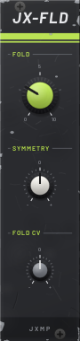
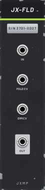
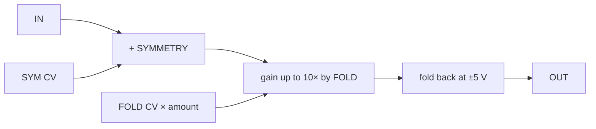

# JX-FLD — Folder

A wavefolder: the wave is amplified up to 10× and folded back whenever it leaves ±5 V, so it gets brighter and more
metallic but stays within ±5 V.

6 HP · Filter / shaper · Polyphonic · [all modules](README.md)

 

## What it does

Where a filter removes harmonics, a wavefolder adds them. A smooth sine becomes a rich, bright tone, and moving the
fold amount gives the "west coast" sound: plucks and bells without a filter.

## How it works

- The input is shifted by SYMMETRY, amplified by FOLD and folded each time it leaves ±5 V.
- Works best on a sine or triangle at ±5 V; louder inputs fold more already.

## Quick start

1. [JX-OSC](jx-osc.md) SIN → **IN**, **OUT** → [JX-AMP](jx-amp.md).
2. Turn **FOLD** slowly from 0: the tone gets brighter in steps.

## Front panel

| Control | Range | What it does |
|---|---|---|
| FOLD | 0 … 100 % (30) | How many times the wave is folded. |
| SYMMETRY | −100 … +100 % (0) | Shifts the wave before folding: uneven, hollower folds. |
| FOLD CV | −100 … +100 % | How much FOLD CV moves FOLD (negative inverts). |

## Back panel (sockets)

`Tab` or `F2` turns the rack round.

| Socket | Signal | What it does |
|---|---|---|
| IN | Audio, poly | Signal to fold, best ±5 V. |
| FOLD CV | CV | Modulates FOLD (an envelope or LFO). |
| SYM CV | CV ±5 V | Shifts SYMMETRY. |
| OUT | Audio ±5 V | The folded wave. |

## Patch ideas

- **West-coast pluck:** SIN → IN, a short [JX-ENV](jx-env.md) into FOLD CV and into the VCA: bright attack, mellow tail.
- **Moving drone:** a slow [JX-LFO](jx-lfo.md) on SYM CV.
- **Bass grit:** a TRI bass with FOLD 15 % before the filter.

## See also

[JX-RNG](jx-rng.md) · [JX-FLT](jx-flt.md) · [JX-OSC](jx-osc.md)
