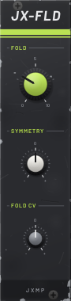
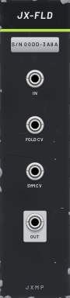

# JX-FLD — Folder

6 HP · JXMP Audio · [all modules](README.md)

Wavefolder: the wave is amplified up to 10× and folded back whenever it leaves ±5 V, so it gets brighter and more metallic but stays within ±5 V. Polyphonic.

 

## Front panel

| Control | What it does |
|---|---|
| FOLD | How many times the wave is folded. |
| SYMMETRY | Shifts the wave before folding: uneven, hollower folds. |
| FOLD CV | How much the FOLD CV socket moves FOLD (± for inverted). |

## Sockets (back, `Tab` turns the rack)

| Socket | What it does |
|---|---|
| IN | Audio to fold, best a sine or triangle (±5 V). |
| FOLD CV | Modulates FOLD (an envelope or LFO). |
| SYM CV | 0 to ±5 V shifts SYMMETRY. |
| OUT | The folded wave. |

## How to use it

- West-coast pluck: JX-OSC SIN → IN, an envelope into FOLD CV, then JX-AMP (no filter needed).
- A slow LFO on SYM CV makes a static tone move.
