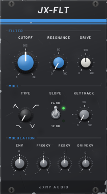
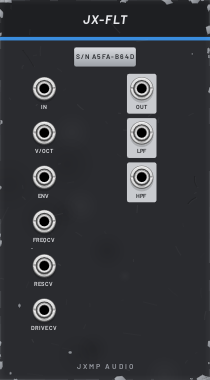

# JX-FLT — VCF

14 HP · JXMP Audio · [all modules](README.md)

Ladder filter with four types, 12 or 24 dB slope, resonance up to self-oscillation, drive, keytracking and a bipolar envelope input. Polyphonic.

 

## Front panel

| Control | What it does |
|---|---|
| CUTOFF | Cutoff frequency, a tick per octave; the centre is C4 (262 Hz). |
| RESONANCE | Emphasis at the cutoff; near the top the filter whistles on its own. |
| DRIVE | Saturation before the filter: negative cleaner, positive warmer and louder. |
| TYPE | LP lowpass, BP bandpass, HP highpass, NOTCH. |
| SLOPE  24 DB / 12 DB | 24 dB is steep and dark, 12 dB softer and brighter. |
| KEYTRACK | How much the cutoff follows the V/OCT socket; 100 % keeps the tone the same over the keyboard. |
| ENV | How far the ENV socket moves the cutoff, ±5 octaves for 10 V at full; negative closes it instead. |
| FREQ CV, RES CV, DRIVE CV | How much each CV socket moves its knob, ±100 %. |

## Sockets (back, `Tab` turns the rack)

| Socket | What it does |
|---|---|
| IN | Audio to filter. Polyphonic. |
| V/OCT | Pitch for keytracking. |
| ENV | Envelope (JX-ENV ENV) or other modulation for the cutoff. |
| FREQ CV | Cutoff CV, octaves per volt. |
| RES CV, DRIVE CV | 10 V = the full knob range. |
| OUT | The selected TYPE and SLOPE. |
| LPF, HPF | Always the 24 dB lowpass / highpass, whatever TYPE is set. |

## How to use it

- Classic pluck: CUTOFF low, ENV +50 %, JX-ENV with short decay and low sustain into ENV.
- KEYTRACK 100 % with RESONANCE at the top turns the filter into a sine oscillator played from V/OCT.
- LPF and HPF at the same time: split a sound into bass and top for two effect chains.
