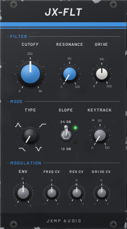
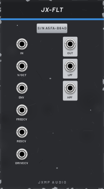
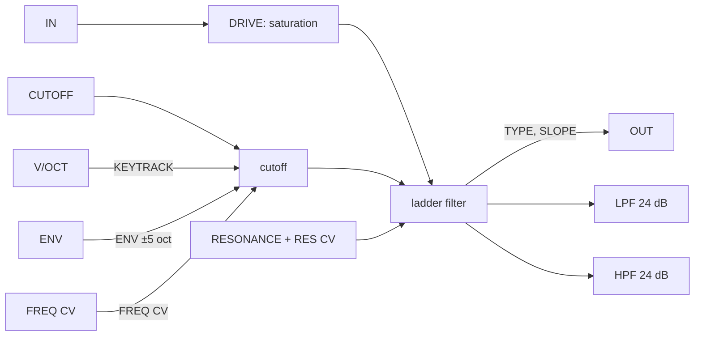

# JX-FLT — VCF

A ladder filter with four types, 12 or 24 dB slope, drive, keytracking and an envelope input.

14 HP · Filter / shaper · Polyphonic · [all modules](README.md)

 

## What it does

JX-FLT shapes the tone of a sound by removing frequencies. A lowpass makes it darker, a highpass thinner, a bandpass
leaves only a band, a notch cuts one out. Resonance adds a peak at the cutoff and, near the top, makes the filter
whistle on its own. An envelope on the cutoff gives the classic "wow" of a synth note.

## How it works

- The cutoff adds up: CUTOFF knob + V/OCT × KEYTRACK + ENV × ENV amount + FREQ CV × FREQ CV amount (all in octaves).
- DRIVE saturates the input before the filter; negative values are cleaner, positive warmer and louder.
- OUT follows TYPE and SLOPE; LPF and HPF always give the 24 dB lowpass and highpass, at the same time.
- Every channel of IN is filtered on its own (polyphony).

## Quick start

1. [JX-OSC](jx-osc.md) SAW → **IN**, **OUT** → [JX-AMP](jx-amp.md).
2. Turn **CUTOFF** down until the sound is dark, **RESONANCE** to about 40 %.
3. Patch a [JX-ENV](jx-env.md) ENV into the **ENV** socket and turn the **ENV** knob to +50 %: each note opens
   the filter and closes again.

## Front panel

| Control | Range | What it does |
|---|---|---|
| CUTOFF | 8 Hz – 8 kHz (C4 in the middle) | Cutoff frequency, logarithmic. |
| RESONANCE | 0 … 100 % | Peak at the cutoff; near the top the filter self-oscillates. |
| DRIVE | −100 … +100 % | Saturation before the filter. |
| TYPE | LP, BP, HP, NOTCH | Filter type on OUT. |
| SLOPE (24 DB / 12 DB) | 24 dB default | 24 dB is steep and dark, 12 dB softer and brighter. |
| KEYTRACK | 0 … 100 % | How much the cutoff follows V/OCT; 100 % keeps the tone the same over the keyboard. |
| ENV | −100 … +100 % | How far the ENV socket moves the cutoff: ±5 octaves for 10 V at full; negative closes it. |
| FREQ CV, RES CV, DRIVE CV | −100 … +100 % | How much each CV socket moves its knob. |

## Back panel (sockets)

`Tab` or `F2` turns the rack round.

| Socket | Signal | What it does |
|---|---|---|
| IN | Audio, poly | Signal to filter. |
| V/OCT | V/Oct | Pitch for keytracking. |
| ENV | CV 0–10 V | Envelope (or any modulation) for the cutoff, scaled by ENV. |
| FREQ CV | CV | Cutoff CV, octaves per volt, scaled by FREQ CV. |
| RES CV | CV | 10 V = the full resonance range, scaled by RES CV. |
| DRIVE CV | CV | 10 V = the full drive range, scaled by DRIVE CV. |
| OUT | Audio | The selected TYPE and SLOPE. |
| LPF | Audio | 24 dB lowpass, whatever TYPE is set. |
| HPF | Audio | 24 dB highpass, whatever TYPE is set. |

## Everything it can do

- Four types (LP, BP, HP, notch), two slopes.
- Resonance up to self-oscillation: with KEYTRACK 100 % it plays as a sine oscillator from V/OCT.
- A bipolar envelope amount: the envelope can open or close the filter.
- Simultaneous LPF and HPF outputs for splitting a sound into bass and top.
- Drive with its own CV for growl that follows the music.

## Patch ideas

- **Pluck:** CUTOFF low, RESONANCE 30 %, ENV +50 %, a JX-ENV with 0 ms attack, 150 ms decay, 0 sustain.
- **Acid bass:** 24 dB, RESONANCE 70 %, DRIVE +40 %, a short envelope and a [JX-SEQ](jx-seq.md) with accents on RES CV.
- **Wah:** BP, a slow [JX-LFO](jx-lfo.md) TRI into FREQ CV.
- **Split processing:** LPF to a dry channel, HPF through [JX-DLY](jx-dly.md): echoes on the top only.
- **Filter as oscillator:** no IN, RESONANCE at the top, KEYTRACK 100 %, V/OCT from the keyboard.

## Good to know

- KEYTRACK needs V/OCT patched; without it the knob does nothing.
- High resonance with a loud input can clip the next module: lower the level or use DRIVE negative.
- The cutoff goes up to 0.18 × the sample rate (about 8.6 kHz at 48 kHz, 17 kHz at 96 kHz), so a fully open filter
  sounds a little brighter at a higher sample rate.

## See also

[JX-OSC](jx-osc.md) · [JX-ENV](jx-env.md) · [JX-AMP](jx-amp.md) · [JX-LFO](jx-lfo.md) · [JX-FLD](jx-fld.md)
