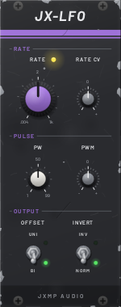
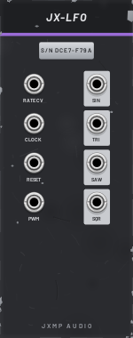
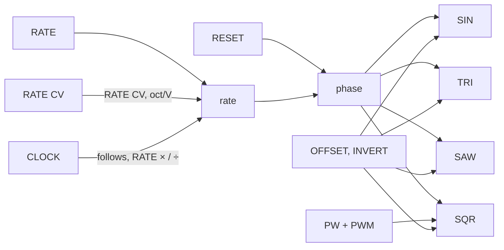

# JX-LFO — LFO

A low-frequency oscillator with four shapes, 0.004 Hz – 1 kHz, clock sync, reset, pulse width, unipolar / bipolar
output and invert.

10 HP · Envelope / modulation · Polyphonic · [all modules](README.md)

 

## What it does

An LFO is a slow oscillator used to move other things: vibrato on pitch, a sweeping filter, tremolo on a VCA, a
changing pulse width. It can run on its own or follow the tempo through a clock.

## How it works

- RATE goes from 0.004 Hz to 1 kHz; the default is 2 Hz. RATE CV adds octaves per volt.
- With a CLOCK cable the LFO locks to the clock, and RATE multiplies or divides it (the centre = the clock's rate).
- RESET restarts the cycle on a trigger.
- OFFSET BI gives ±5 V, UNI gives 0–10 V; INVERT turns every shape upside down.
- The light blinks with the phase. Every channel of RATE CV runs its own LFO.

## Quick start

1. **TRI** → [JX-FLT](jx-flt.md) FREQ CV, turn FREQ CV on the filter to 30 %.
2. Set **RATE** to about 0.5 Hz: the filter sweeps slowly.

## Front panel

| Control | Range | What it does |
|---|---|---|
| RATE | 0.004 Hz – 1 kHz (2 Hz) | Speed; with CLOCK patched a multiplier / divider of the clock. |
| RATE CV | −100 … +100 % | How much the RATE CV socket moves the rate. |
| PW | 1 … 99 % | Pulse width of the square. |
| PWM | −100 … +100 % | How much the PWM socket moves PW. |
| OFFSET (UNI / BI) | BI default | BI ±5 V, UNI 0–10 V. |
| INVERT (INV / NORM) | NORM default | Turns the shapes upside down. |

## Back panel (sockets)

`Tab` or `F2` turns the rack round.

| Socket | Signal | What it does |
|---|---|---|
| RATE CV | CV, poly | Rate CV in octaves per volt; one LFO per channel. |
| CLOCK | Clock | The LFO follows this clock. |
| RESET | Trigger | Restarts the cycle. |
| PWM | CV | Pulse width CV. |
| SIN, TRI, SAW, SQR | CV ±5 V or 0–10 V | The four shapes. |

## Everything it can do

- Very slow (one cycle in 4 minutes) to audio rate (1 kHz) for FM effects.
- Tempo sync through any clock ([JX-CLK](jx-clk.md), Host MIDI CLOCK), with ratios.
- Polyphonic: one LFO per voice, so every note can wobble on its own.
- Unipolar output for things that should not go negative (VCA levels, mix amounts).

## Patch ideas

- **Vibrato:** SIN at 5 Hz into [JX-OSC](jx-osc.md) FM (EXP), FM at 2–3 %.
- **Tempo wobble:** JX-CLK BEAT into CLOCK, SQR or TRI into JX-FLT FREQ CV.
- **Same start every note:** the note gate into RESET.
- **Tremolo:** UNI, SIN into [JX-AMP](jx-amp.md) CV.
- **Slow random-ish drift:** two JX-LFOs at unrelated slow rates mixed in [JX-MIX](jx-mix.md).

## Good to know

- The CLOCK input measures the time between pulses, so it locks after the second pulse.
- For stepped random values use [JX-RND](jx-rnd.md); for smooth shapes with a tempo, this.

## See also

[JX-ENV](jx-env.md) · [JX-RND](jx-rnd.md) · [JX-CLK](jx-clk.md) · [JX-ATT](jx-att.md)
