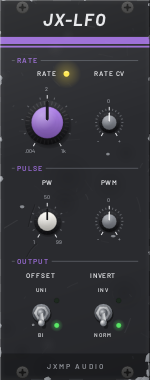
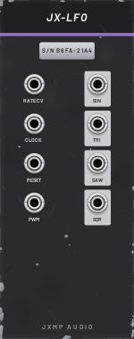

# JX-LFO — LFO

10 HP · JXMP Audio · [all modules](README.md)

Low-frequency oscillator with four shapes, 0.004 Hz to 1 kHz, external clock sync, pulse width, unipolar or bipolar output and invert. Polyphonic.

 

## Front panel

| Control | What it does |
|---|---|
| RATE | Speed; the default is 2 Hz. With CLOCK patched it multiplies or divides the clock instead (centre = the clock's rate). |
| RATE CV | How much the RATE CV socket moves the rate, ±100 %. |
| PW | Pulse width of the square. |
| PWM | How much the PWM socket moves the pulse width. |
| OFFSET  UNI / BI | BI: ±5 V. UNI: 0–10 V (for levels, VCA CV, things that should not go negative). |
| INVERT  INV / NORM | Turns every shape upside down. |

## Sockets (back, `Tab` turns the rack)

| Socket | What it does |
|---|---|
| RATE CV | Rate CV in octaves per volt. Polyphonic: one LFO per channel. |
| CLOCK | The LFO follows this clock; RATE then multiplies or divides it. |
| RESET | A trigger restarts the cycle. |
| PWM | Pulse width CV. |
| SIN, TRI, SAW, SQR | The four shapes. |

## How to use it

- Vibrato: SIN at 5 Hz into JX-OSC FM (EXP) with FM at a few percent.
- Tempo-synced wobble: JX-CLK BEAT into CLOCK, SQR or TRI into JX-FLT FREQ CV.
- Retrigger per note: the note gate into RESET so every note starts the sweep from the same point.
