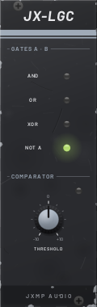
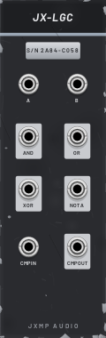

# JX-LGC — Logic

8 HP · JXMP Audio · [all modules](README.md)

Logic of two gates (AND, OR, XOR, NOT A) and a comparator with threshold. Polyphonic.

 

## Front panel

| Control | What it does |
|---|---|
| GATES A · B | LEDs of the five outputs (AND, OR, XOR, NOT A, CMP). |
| THRESHOLD | −10 to +10 V: CMP OUT is high while CMP IN is above it. |

## Sockets (back, `Tab` turns the rack)

| Socket | What it does |
|---|---|
| A, B | Gates, high above 1 V. |
| CMP IN | Any voltage to compare with THRESHOLD. |
| AND | High while A and B are both high. |
| OR | High while A or B (or both) is high. |
| XOR | High while exactly one is high. |
| NOT A | High while A is low. |
| CMP OUT | 10 V while CMP IN is above THRESHOLD. |

## How to use it

- Combine rhythms: two JX-EUC gates into A and B; AND plays only where both hit, XOR where only one does.
- Pulse wave from any LFO: the LFO into CMP IN, THRESHOLD sets the width.
- Gate from an envelope: ENV into CMP IN, THRESHOLD 5 V.
