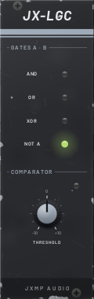
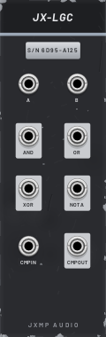
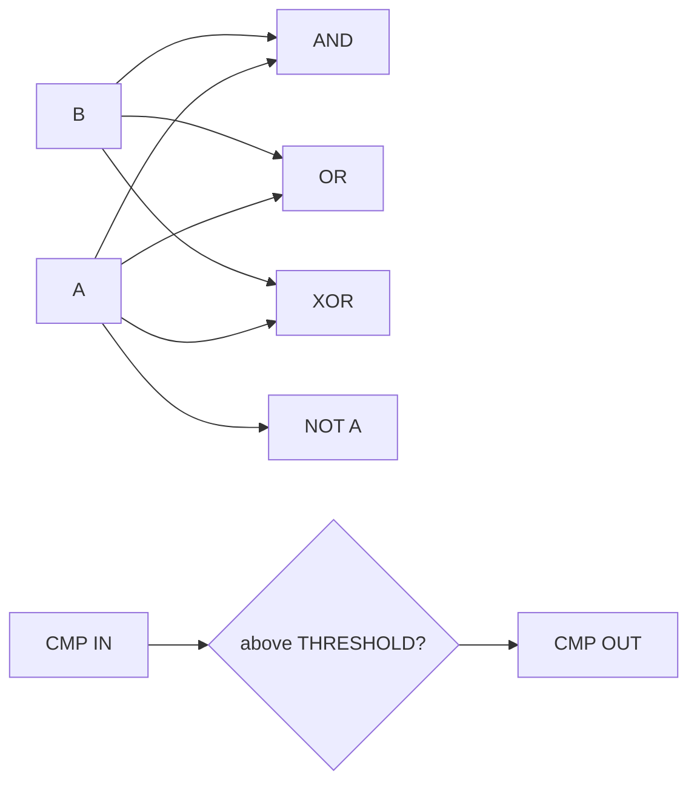

# JX-LGC — Logic

Logic of two gates (AND, OR, XOR, NOT A) and a comparator with a threshold.

8 HP · Utility · Polyphonic · [all modules](README.md)

 

## What it does

JX-LGC combines rhythms and turns voltages into gates. Two drum patterns can make a third ("only where both hit"),
and any LFO or envelope can switch something on above a chosen voltage.

## How it works

- A and B count as high above 1 V. The outputs are 10 V gates.
- The five LEDs show the outputs.

## Quick start

1. Two [JX-EUC](jx-euc.md) GATE outputs into **A** and **B**.
2. **XOR** → a [JX-DRM](jx-drm.md) trigger: hits where exactly one pattern plays.

## Front panel

| Control | Range | What it does |
|---|---|---|
| GATES A · B | LEDs | AND, OR, XOR, NOT A, CMP. |
| THRESHOLD | −10 … +10 V (0) | CMP OUT is high while CMP IN is above it. |

## Back panel (sockets)

`Tab` or `F2` turns the rack round.

| Socket | Signal | What it does |
|---|---|---|
| A, B | Gate, poly | Inputs, high above 1 V. |
| CMP IN | Any | Voltage to compare with THRESHOLD. |
| AND | Gate | High while A and B are both high. |
| OR | Gate | High while A or B is high. |
| XOR | Gate | High while exactly one is high. |
| NOT A | Gate | High while A is low. |
| CMP OUT | Gate | 10 V while CMP IN is above THRESHOLD. |

## Patch ideas

- **Combine rhythms:** two JX-EUC gates; AND plays only where both hit.
- **Pulse from an LFO:** the LFO into CMP IN, THRESHOLD sets the pulse width.
- **Gate from an envelope:** [JX-ENV](jx-env.md) ENV into CMP IN, THRESHOLD 5 V.
- **Off-beats:** a beat into A, NOT A into a trigger: the gaps between beats.

## See also

[JX-EUC](jx-euc.md) · [JX-SW](jx-sw.md) · [JX-CLK](jx-clk.md)
