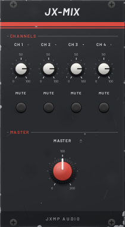
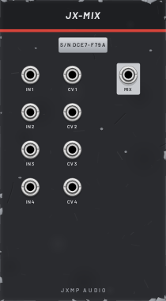

# JX-MIX — Mixer

14 HP · JXMP Audio · [all modules](README.md)

Four-channel utility mixer for audio or CV, with level, level CV and mute per channel and a master up to 200 %. Polyphonic. For the main stereo mix of a project use JX-CONSOLE.

 

## Front panel

| Control | What it does |
|---|---|
| CH 1–4 level | Channel level; the LED shows the signal. |
| MUTE | Mutes the channel. |
| MASTER | Level of the sum, up to 200 %. |

## Sockets (back, `Tab` turns the rack)

| Socket | What it does |
|---|---|
| IN 1–4 | Channel inputs (audio or CV). A mono input is spread over all channels of a polyphonic mix. |
| CV 1–4 | Channel level CV: 0 V closed, 10 V open (times the knob). |
| MIX | Sum of the unmuted channels × levels × MASTER. |

## How to use it

- Mix two oscillators before one filter.
- Sum several modulation sources into one CV (LFO + envelope + offset from JX-ATT).
