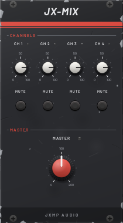
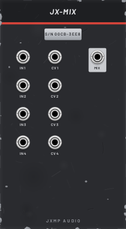
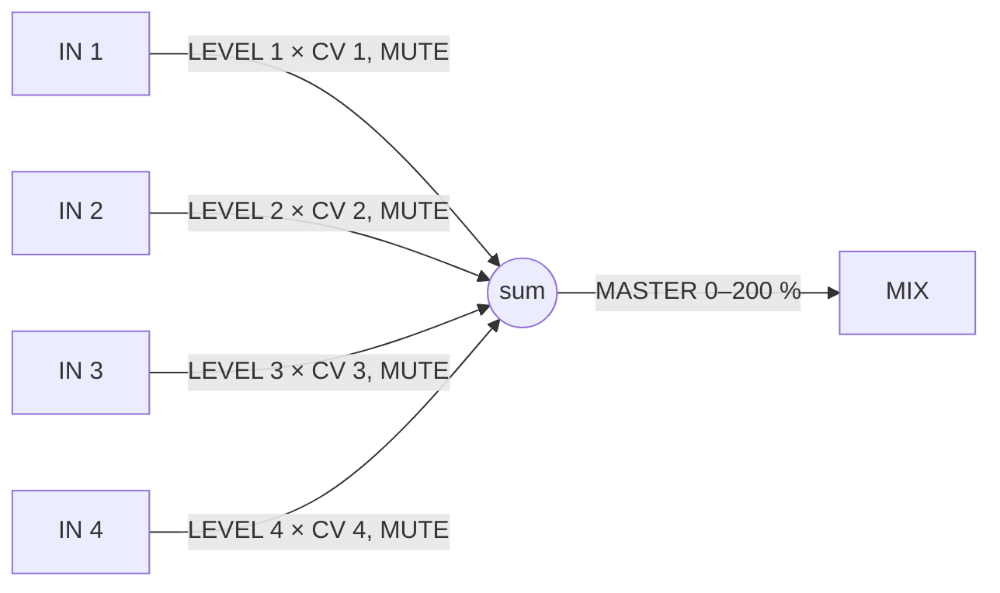

# JX-MIX — Mixer

A four-channel utility mixer for audio or CV, with level, level CV and mute per channel and a master up to 200 %.

14 HP · Mixing / routing · Polyphonic · [all modules](README.md)

 

## What it does

JX-MIX adds up to four signals into one: two oscillators before a filter, several drums into one bus, or several
modulation sources into one CV. For the main stereo mix of a song use [JX-CONSOLE](jx-console.md), which has pan, EQ,
sends and the Mixer view.

## How it works

- Each channel: IN × LEVEL × CV (0 V closed, 10 V open; no cable = open), unless MUTE is on.
- The output has as many channels as the widest input; a mono input is spread over all channels of a polyphonic mix.
- The LED of each channel shows its level.

## Quick start

1. Two [JX-OSC](jx-osc.md) outputs into **IN 1** and **IN 2**.
2. **MIX** → [JX-FLT](jx-flt.md) IN. Balance the oscillators with the channel knobs.

## Front panel

| Control | Range | What it does |
|---|---|---|
| CH 1–4 level | 0 … 100 % (80) | Channel level; the LED shows the signal. |
| MUTE 1–4 | on / muted | Silences the channel. |
| MASTER | 0 … 200 % (100) | Level of the sum. |

## Back panel (sockets)

`Tab` or `F2` turns the rack round.

| Socket | Signal | What it does |
|---|---|---|
| IN 1–4 | Audio / CV, poly | Channel inputs. |
| CV 1–4 | CV 0–10 V | Channel level CV (times the knob). |
| MIX | Same as inputs | Sum of the unmuted channels × levels × MASTER. |

## Everything it can do

- Mixes audio or CV alike (DC passes), polyphonic.
- A VCA per channel through the CV inputs.
- MASTER up to 200 % to make up for quiet sources.

## Patch ideas

- **Two oscillators, one filter:** SAW and SQR of two JX-OSCs a fifth apart → MIX → JX-FLT.
- **Drum bus:** [JX-DRM](jx-drm.md) voices into IN 1–4, MIX into one console channel.
- **Combined modulation:** [JX-LFO](jx-lfo.md) + [JX-ENV](jx-env.md) + an offset from [JX-ATT](jx-att.md) into one CV.
- **Crossfade:** a UNI LFO into CV 1 and its inverse ([JX-ATT](jx-att.md) gain −1, offset +10 V) into CV 2.

## Good to know

- The sum is limited to ±12 V: four loud signals with MASTER at 200 % flatten there, so turn down instead.

## See also

[JX-CONSOLE](jx-console.md) · [JX-AMP](jx-amp.md) · [JX-ATT](jx-att.md)
