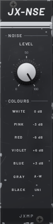
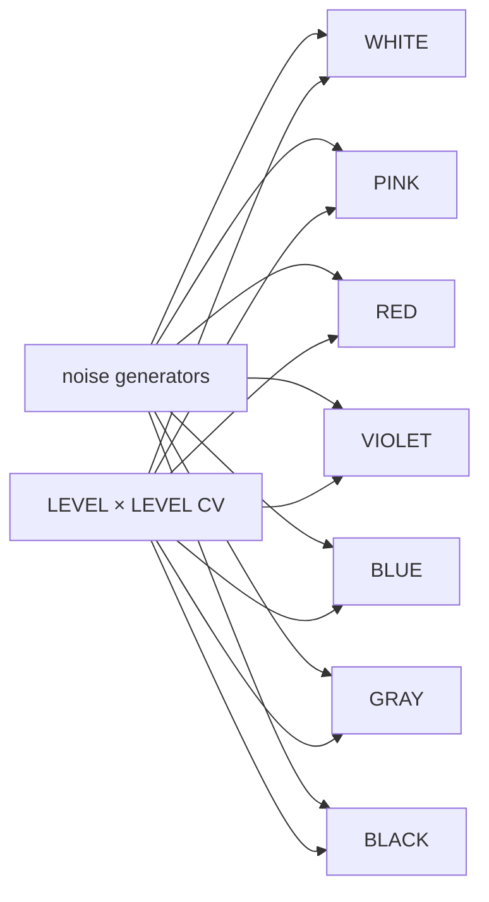

# JX-NSE — Noise

Noise in seven colours at the same loudness, with a level knob and a level CV.

6 HP · Sound source · Mono · [all modules](README.md)

 

## What it does

Noise is a sound without pitch: hiss, wind, the "tss" of a hi-hat, the breath of a pad. It is also a source of random
voltages. JX-NSE gives seven kinds at once, from bright to dark.

## How it works

- The colours differ in how energy is spread over frequencies (the slope per octave).
- All outputs are calibrated to sound about equally loud; LEVEL and LEVEL CV scale all of them.

## Quick start

1. **WHITE** → [JX-FLT](jx-flt.md) IN (type HP), OUT → [JX-AMP](jx-amp.md).
2. A short [JX-ENV](jx-env.md) (AD, 60 ms decay) on the VCA, triggered by a clock: a hi-hat.

## Front panel

| Control | Range | What it does |
|---|---|---|
| LEVEL | 0 … 100 % (100) | Level of all outputs. |
| COLOURS | legend | The seven outputs on the back, from bright to dark. |

## Back panel (sockets)

`Tab` or `F2` turns the rack round.

| Socket | Signal | What it does |
|---|---|---|
| LEVEL CV | CV 0–10 V | 0 V silent, 10 V full (times LEVEL). |
| WHITE | Audio | Equal energy at every frequency: bright hiss. |
| PINK | Audio | −3 dB/octave: natural rushing (wind, sea). |
| RED | Audio | −6 dB/octave: deep rumble; also a slow random CV. |
| VIOLET | Audio | +6 dB/octave: very thin and bright. |
| BLUE | Audio | +3 dB/octave: bright, thinner than white. |
| GRAY | Audio | Shaped so every frequency sounds equally loud to the ear. |
| BLACK | CV ±5 V | Random values spread evenly over ±5 V: random CV. |

## Everything it can do

- Seven noise colours at the same time.
- A level CV, so an envelope can play the noise directly without a VCA.
- Random CV sources: RED (slow, wandering), BLACK (even spread).

## Patch ideas

- **Hi-hat / snare layer:** WHITE → JX-FLT HP → JX-AMP with a short envelope.
- **Wind:** PINK → JX-FLT BP, a slow [JX-LFO](jx-lfo.md) on FREQ CV, RESONANCE 50 %.
- **Breath in a pad:** PINK quietly into the pad's filter input next to the oscillator.
- **Random melody:** BLACK → [JX-RND](jx-rnd.md) IN (clocked) → [JX-QNT](jx-qnt.md).

## Good to know

- Noise is mono: one channel per output.

## See also

[JX-RND](jx-rnd.md) · [JX-FLT](jx-flt.md) · [JX-DRM](jx-drm.md)
