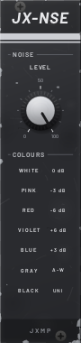
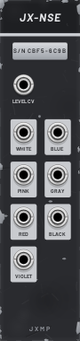

# JX-NSE — Noise

6 HP · JXMP Audio · [all modules](README.md)

Noise in seven colours, all at the same loudness, with one level knob and a level CV.

 

## Front panel

| Control | What it does |
|---|---|
| LEVEL | Level of all outputs. |
| COLOURS | Legend of the seven outputs on the back. |

## Sockets (back, `Tab` turns the rack)

| Socket | What it does |
|---|---|
| LEVEL CV | 0 V silent, 10 V full (times LEVEL). |
| WHITE | Equal energy at every frequency: bright hiss. |
| PINK | −3 dB/octave: natural rushing sound (wind, sea). |
| RED | −6 dB/octave: deep rumble, also a slow random CV. |
| VIOLET | +6 dB/octave: very thin and bright. |
| BLUE | +3 dB/octave: bright, thinner than white. |
| GRAY | Shaped so every frequency sounds equally loud to the ear. |
| BLACK | Random values spread evenly over ±5 V: random CV. |

## How to use it

- Hi-hat or snare layer: WHITE → JX-FLT (HP) → JX-AMP with a short envelope.
- Wind: PINK through a bandpass JX-FLT with a slow JX-LFO on the cutoff.
- Random melody: BLACK into JX-RND IN, clocked, then JX-QNT.
