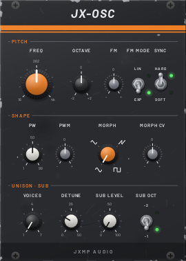
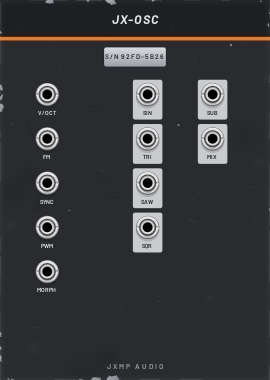
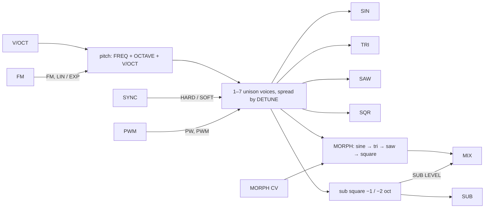

# JX-OSC — VCO

The main oscillator: four classic shapes, a morphing output, a sub oscillator and up to seven unison voices.

18 HP · Sound source · Polyphonic · [all modules](README.md)

 

## What it does

JX-OSC makes the raw tone of a voice. It plays sine, triangle, saw and square at once on their own outputs, and a
MIX output that glides between those four shapes with a sub oscillator added underneath. Several detuned copies
(unison) make it thick, FM and sync make it metallic or aggressive.

## How it works

- Pitch is FREQ (±54 semitones around C4) + OCTAVE (±2 octaves) + the V/OCT socket (1 V per octave, 0 V = C4).
- With VOICES above 1, each note plays several oscillators spread evenly over ±DETUNE cents. They are summed and
  scaled by 1/√voices, so the level stays about the same.
- The sub oscillator is a square locked to the first voice, one or two octaves down.
- Every channel of the V/OCT cable gets its own oscillator (polyphony); the outputs carry as many channels.

## Quick start

1. Patch a [Host MIDI](../CARDINAL-MODULES.md) V/OCT (through a [JX-PB](jx-pb.md)) into **V/OCT**.
2. Take **SAW** into [JX-FLT](jx-flt.md) IN, then [JX-AMP](jx-amp.md) with a [JX-ENV](jx-env.md) on its CV.
3. Play: you hear a bright saw. Turn **MORPH** and listen on **MIX** to sweep the shape.

## Front panel

| Control | Range | What it does |
|---|---|---|
| FREQ | C4 ±54 semitones (≈ 12 Hz – 5.9 kHz) | Base pitch; the centre is C4 (262 Hz). |
| OCTAVE | −2 … +2 | Shifts the pitch in whole octaves. |
| FM | −100 … +100 % | How much the FM socket moves the pitch; negative inverts it. |
| FM MODE (LIN / EXP) | EXP default | EXP: octaves per volt (vibrato, sweeps). LIN: linear FM (in Hz), stays in tune for bell and metal tones. Not through-zero: the frequency stops at 0 Hz. |
| SYNC (HARD / SOFT) | HARD default | HARD restarts the cycle on each rising edge at SYNC; SOFT reverses it (gentler). |
| PW | 1 … 99 % | Pulse width of the square; 50 % is a true square, narrow is nasal. |
| PWM | −100 … +100 % | How much the PWM socket moves PW. |
| MORPH | sine → triangle → saw → square | Shape on MIX, blending smoothly between neighbours. |
| MORPH CV | −100 … +100 % | How much the MORPH socket moves MORPH (10 V = the whole range). |
| VOICES | 1 … 7 | Unison oscillators per note. |
| DETUNE | 0 … 50 cents (15) | Spread of the unison voices. |
| SUB LEVEL | 0 … 100 % | Sub oscillator level in MIX (the SUB output always plays at full level). |
| SUB OCT (−1 / −2) | −1 default | Sub one or two octaves below. |

## Back panel (sockets)

`Tab` or `F2` turns the rack round.

| Socket | Signal | What it does |
|---|---|---|
| V/OCT | V/Oct, poly | Pitch, 1 V per octave, 0 V = C4. One oscillator per channel. |
| FM | CV | Frequency modulation, amount by FM, mode by FM MODE. |
| SYNC | Audio / gate | Sync source, usually another oscillator. |
| PWM | CV | Pulse width CV, amount by PWM (10 V = the full range). |
| MORPH | CV | Morph CV, amount by MORPH CV. |
| SIN, TRI | Audio ±5 V | Sine and triangle, all unison voices summed. |
| SAW | Audio ±5 V | Sawtooth, centred on 0 V (no DC). |
| SQR | Audio ±5 V | Square / pulse, width by PW. |
| SUB | Audio ±5 V | The sub square on its own, full level. |
| MIX | Audio | The morphed shape plus the sub at SUB LEVEL. |

## Everything it can do

- Four shapes at once, plus a morphing shape: use several outputs for layered sounds.
- Unison up to 7 voices per note, also in polyphony (up to 16 notes, each with its own unison).
- Exponential or linear FM; hard or soft sync.
- Pulse width and its modulation for the classic PWM string sound.
- A sub oscillator one or two octaves down, mixed in or on its own output.
- Safe: if a channel ever produces an invalid value it restarts silently instead of locking up; outputs are limited
  to ±12 V.

## Patch ideas

- **Fat bass:** SAW → JX-FLT, SUB LEVEL 50 %, SUB OCT −1, VOICES 2, DETUNE 8.
- **Supersaw pad:** VOICES 5–7, DETUNE 15–25 cents, then [JX-CHR](jx-chr.md) and [JX-REV](jx-rev.md).
- **Strings:** SQR with PW 30 %, a slow [JX-LFO](jx-lfo.md) TRI into PWM with PWM at 40 %.
- **Hard sync lead:** a second JX-OSC SQR into SYNC; sweep this one's FREQ or put an envelope into FM.
- **Bell:** FM MODE LIN, another JX-OSC SIN into FM, FM at 30 %, a short decay envelope on the VCA.

## Good to know

- Without anything in V/OCT the oscillator plays FREQ (C4 at the centre).
- More unison voices cost more CPU: 7 voices × 16 channels is the heaviest case.
- Everything is saved in the patch through the knob positions; there is no hidden state.

## See also

[JX-FLT](jx-flt.md) · [JX-ENV](jx-env.md) · [JX-AMP](jx-amp.md) · [JX-LFO](jx-lfo.md) · [JX-FLD](jx-fld.md) · [JX-RNG](jx-rng.md)
