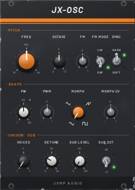
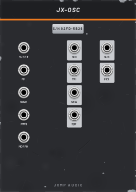

# JX-OSC — VCO

18 HP · JXMP Audio · [all modules](README.md)

Oscillator with four classic shapes, a morph output that sweeps between them, a sub oscillator and up to seven detuned unison voices. Polyphonic: one oscillator per channel of the V/OCT cable.

 

## Front panel

| Control | What it does |
|---|---|
| FREQ | Base pitch, 16 Hz to 4 kHz; the centre is C4 (262 Hz). |
| OCTAVE | Shifts the pitch by −2 to +2 octaves in whole steps. |
| FM | How much the FM socket moves the pitch, ±100 % (negative inverts it). |
| FM MODE  LIN / EXP | EXP: FM in octaves per volt (vibrato, sweeps). LIN: linear through-zero FM (bell and metal tones that stay in tune). |
| SYNC  HARD / SOFT | HARD restarts the cycle on every rising edge at SYNC; SOFT reverses it (gentler). |
| PW | Pulse width of the square, 1–99 %; 50 % is a true square. |
| PWM | How much the PWM socket moves the pulse width, ±100 %. |
| MORPH | Shape on the MIX output: sine → triangle → saw → square, blending in between. |
| MORPH CV | How much the MORPH socket moves MORPH, ±100 %. |
| VOICES | Unison: 1 to 7 oscillators per note, spread by DETUNE. |
| DETUNE | Spread of the unison voices, 0–50 cents. |
| SUB LEVEL | How loud the sub oscillator is in MIX; at 0 it is off in MIX (the SUB output always plays). |
| SUB OCT  −1 / −2 | Sub oscillator one or two octaves below. |

## Sockets (back, `Tab` turns the rack)

| Socket | What it does |
|---|---|
| V/OCT | Pitch, 1 V per octave, 0 V = C4. Polyphonic. |
| FM | Frequency modulation, amount set by FM. |
| SYNC | Sync input, e.g. a second JX-OSC. |
| PWM | Pulse width CV, amount set by PWM. |
| MORPH | Morph CV, amount set by MORPH CV. |
| SIN, TRI, SAW, SQR | The four shapes, ±5 V (all unison voices summed). |
| SUB | The sub square on its own, always full level. |
| MIX | The morphed shape plus the sub at SUB LEVEL. |

## How to use it

- Basic voice: MIDI V/OCT → V/OCT, SAW → JX-FLT IN → JX-AMP → console.
- Fat bass: SAW or MIX with SUB LEVEL around 50 % and SUB OCT −1.
- Supersaw pad: VOICES 5–7, DETUNE 15–25 cents, into JX-CHR.
- Slow movement: a JX-LFO into MORPH with MORPH CV at 30 %, or into PWM for the classic pulse-width sweep.
- Hard sync lead: a second JX-OSC SQR into SYNC, then sweep FREQ on this one.
