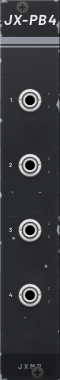
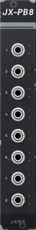
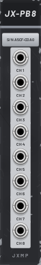
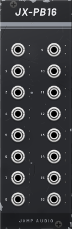
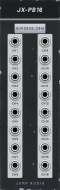

# JX-PB4 / PB8 / PB16 — Patchbay

Passes 4, 8 or 16 channels between the front and the back of the rack.

4 HP (PB4, PB8) · 8 HP (PB16) · Mixing / routing · Polyphonic · [all modules](README.md)

 
 
 

## What it does

In PatchCore the JXMP modules have their knobs on the front and their sockets on the back (`Tab` turns the rack).
Basic modules (Host MIDI, Host Audio, Fundamental, other plugins) have their sockets on the front. A patchbay connects
the two sides: plug something into front jack *n* and it comes out of back jack *n*, or the other way round, without
cables running round the edge of the rack.

## How it works

- Each channel is an input on one side and an output on the other. The first cable decides the direction; remove all
  cables of the channel to change it.
- The LED of each channel shows the direction: green front → back, yellow back → front (brighter with signal).
- Polyphonic cables pass with all their voices.

## Quick start

1. Front: Host MIDI V/OCT and GATE into jacks 1 and 2.
2. `Tab`: on the back, jacks 1 and 2 are now outputs. Take them to [JX-OSC](jx-osc.md) V/OCT and
   [JX-ENV](jx-env.md) GATE.
3. For audio out: on the back, [JX-CONSOLE](jx-console.md) MAIN L / R into jacks 3 and 4; on the front, jacks 3 and 4
   to Host Audio.

## Front and back

| Part | What it does |
|---|---|
| Jacks 1–n (front) | Front side of each channel: input or output, whichever the first cable needs. |
| Jacks 1–n (back) | Back side of the same channel. |
| LEDs | Direction and signal of each channel. |

## Patch ideas

- **Every patch:** Host MIDI → patchbay → JXMP voice; JXMP mix → patchbay → Host Audio.
- **A Fundamental or other plugin module in a JXMP patch:** its front jacks through a patchbay to the back.

## Good to know

- A cable straight from a front jack to a back jack (only from a hand-edited patch) is drawn on the front; use a
  patchbay instead.

## See also

[JX-PLY](jx-ply.md) · [JX-CONSOLE](jx-console.md) · [Cardinal modules](../CARDINAL-MODULES.md)
