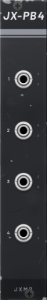
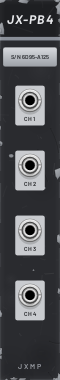
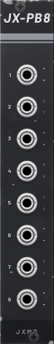
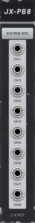
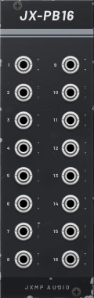
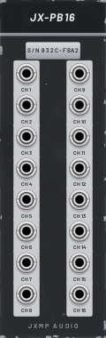

# JX-PB4 / PB8 / PB16 — Patchbay 4 / 8 / 16

4 / 4 / 8 HP · JXMP Audio · [all modules](README.md)

Passes 4, 8 or 16 channels between the front and the back of the rack. Plug something into front jack *n* and it comes out of back jack *n*, or the other way round.

     

## Front panel

| Control | What it does |
|---|---|
| Jacks 1–n | Front side of each channel; each jack is an input or an output, whichever the first cable needs. |
| LEDs | Direction of each channel: green front → back, yellow back → front. |

## Sockets (back, `Tab` turns the rack)

| Socket | What it does |
|---|---|
| Jacks 1–n | Back side of each channel, the same way round. |

## How to use it

- Basic modules have their jacks on the front, JXMP modules on the back: a patchbay connects the two without cables round the edge.
- The first cable decides the direction; remove all cables of the channel to change it.
