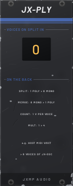
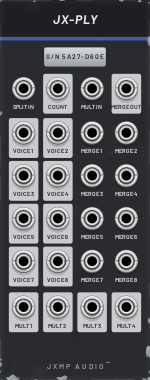

# JX-PLY — Poly

10 HP · JXMP Audio · [all modules](README.md)

Polyphony tools: split a polyphonic cable into 8 mono voices, merge up to 8 mono cables into one, count the voices, and a 1 → 4 mult.

 

## Front panel

| Control | What it does |
|---|---|
| VOICES ON SPLIT IN | Amber digits: how many voices are on SPLIT IN. |

## Sockets (back, `Tab` turns the rack)

| Socket | What it does |
|---|---|
| SPLIT IN | A polyphonic cable (e.g. V/OCT or GATE from Host MIDI). |
| VOICE 1–8 | The voices of SPLIT IN, mono. |
| MERGE 1–8 | Become voices 1–8 of MERGE OUT. |
| MERGE OUT | One polyphonic cable with as many voices as the highest patched MERGE input. |
| COUNT | The number of voices on SPLIT IN, 1 V per voice. |
| MULT IN | Copied to the four MULT outputs (polyphony kept). |
| MULT 1–4 | Copies of MULT IN. |

## How to use it

- Chord from one note: the note and offsets from JX-ATT into MERGE 1–3, MERGE OUT → JX-QNT → one polyphonic JX-OSC.
- Different sounds per voice: SPLIT the MIDI V/OCT and GATE and patch each voice to its own chain.
- One clock to many places: MULT.
