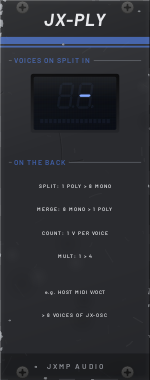
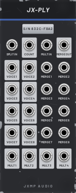
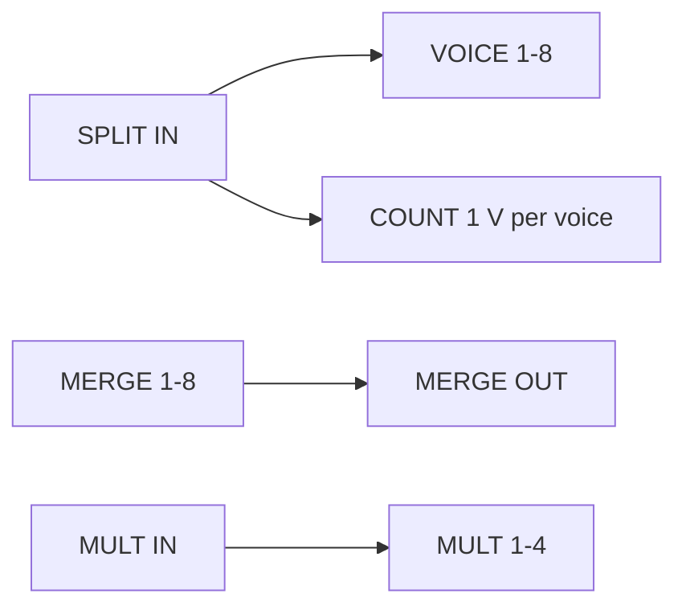

# JX-PLY — Poly

Polyphony tools: split a polyphonic cable into 8 mono voices, merge up to 8 mono cables into one, count the voices,
and a 1 → 4 mult.

10 HP · Utility · Polyphonic · [all modules](README.md)

 

## What it does

One cable in PatchCore can carry up to 16 voices. JX-PLY takes such a cable apart (to give each voice its own chain),
builds one from single cables (to play chords through one polyphonic oscillator), shows how many voices there are and
copies a signal to four places.

## How it works

- MERGE OUT has as many voices as the highest patched MERGE input.
- MULT keeps polyphony: each copy has all voices of MULT IN.
- The amber digits show the number of voices on SPLIT IN.

## Quick start

1. Host MIDI V/OCT (polyphony 4, through a [JX-PB](jx-pb.md)) → **SPLIT IN**.
2. **VOICE 1** and **VOICE 2** → two different oscillators: each voice of a chord gets its own sound.

## Front panel

| Control | Range | What it does |
|---|---|---|
| VOICES ON SPLIT IN | display | How many voices are on SPLIT IN. |

## Back panel (sockets)

`Tab` or `F2` turns the rack round.

| Socket | Signal | What it does |
|---|---|---|
| SPLIT IN | Poly | A polyphonic cable. |
| VOICE 1–8 | Mono | The voices of SPLIT IN. |
| MERGE 1–8 | Mono | Become voices 1–8 of MERGE OUT. |
| MERGE OUT | Poly | One cable with the merged voices. |
| COUNT | CV | Voices on SPLIT IN, 1 V per voice. |
| MULT IN | Any, poly | Copied to the four MULT outputs. |
| MULT 1–4 | Same as MULT IN | Copies. |

## Patch ideas

- **Chord from one note:** the note and offsets from [JX-ATT](jx-att.md) into MERGE 1–3, MERGE OUT →
  [JX-QNT](jx-qnt.md) → one polyphonic [JX-OSC](jx-osc.md).
- **Different sound per voice:** split V/OCT and GATE of the MIDI and patch each voice to its own chain.
- **One clock to many places:** MULT.

## Good to know

- SPLIT gives only the first 8 voices; a 16-voice cable needs two JX-PLY for the rest (or use the voices in poly
  form directly).

## See also

[JX-PB](jx-pb.md) · [JX-ATT](jx-att.md) · [JX-QNT](jx-qnt.md)
