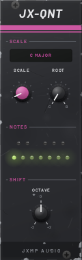
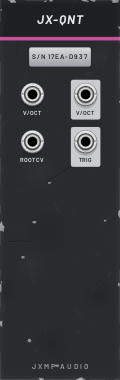

# JX-QNT — Quantizer

8 HP · JXMP Audio · [all modules](README.md)

Moves any pitch CV to the nearest note of a scale. Ten scales, any root, octave shift, a trigger on every new note and a little keyboard of LEDs. Polyphonic.

 

## Front panel

| Control | What it does |
|---|---|
| SCALE | Chromatic, Major, Minor, Dorian, Mixolydian, Harmonic minor, Major pentatonic, Minor pentatonic, Blues, Whole tone. The window shows the name. |
| ROOT | Root note, C to B. |
| NOTES | LED keyboard: the scale's notes glow dim, the playing note bright. |
| OCTAVE | Shifts the output −2 to +2 octaves. |

## Sockets (back, `Tab` turns the rack)

| Socket | What it does |
|---|---|
| V/OCT in | Pitch to quantize, 1 V per octave. Polyphonic. |
| ROOT CV | Root note CV, 1 V per octave, added to ROOT: transposes the scale (chord changes). |
| V/OCT out | The nearest scale note, plus OCTAVE. |
| TRIG | A 1 ms trigger whenever the output note changes. |

## How to use it

- Between JX-SEQ CV (or JX-RND) and JX-OSC V/OCT, so every knob position plays a scale note.
- Generative melody: JX-RND STEP → V/OCT in, TRIG → JX-ENV GATE: a new note plays only when the pitch changes.
