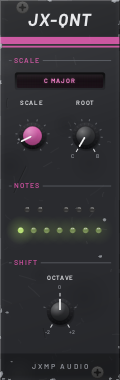
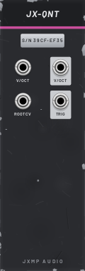
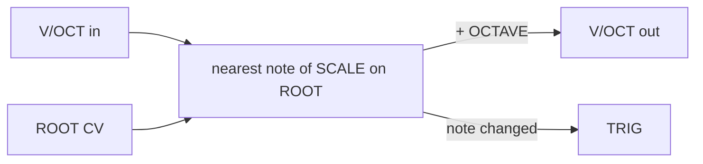

# JX-QNT — Quantizer

Moves any pitch CV to the nearest note of a scale: ten scales, any root, octave shift and a trigger on every new note.

8 HP · Sequencing / time · Polyphonic · [all modules](README.md)

 

## What it does

A sequencer knob or a random voltage can land anywhere between notes. JX-QNT rounds it to the nearest note of the
chosen scale, so everything plays in key. Changing ROOT (or ROOT CV) transposes the whole scale, for chord changes.

## How it works

- 1 V per octave in and out. The scale's notes are compared on the root set by ROOT + ROOT CV.
- TRIG fires a 1 ms trigger whenever the output note changes (not when the input wiggles inside one note).
- The LED keyboard shows the scale's notes dim and the playing note bright; the window shows the scale name.

## Quick start

1. [JX-SEQ](jx-seq.md) CV → **V/OCT in**, **V/OCT out** → [JX-OSC](jx-osc.md) V/OCT.
2. Choose **SCALE** and **ROOT**: every step knob now plays a note of that scale.

## Front panel

| Control | Range | What it does |
|---|---|---|
| SCALE | Chromatic, Major (default), Minor, Dorian, Mixolydian, Harmonic minor, Major pentatonic, Minor pentatonic, Blues, Whole tone | The scale. |
| ROOT | C … B | Root note. |
| OCTAVE | −2 … +2 | Shifts the output in octaves. |
| NOTES | LED keyboard | Scale notes dim, the playing note bright. |

## Back panel (sockets)

`Tab` or `F2` turns the rack round.

| Socket | Signal | What it does |
|---|---|---|
| V/OCT in | V/Oct, poly | Pitch to quantize. |
| ROOT CV | V/Oct | Added to ROOT, 1 V per octave: transposes the scale. |
| V/OCT out | V/Oct | The nearest scale note, plus OCTAVE. |
| TRIG | Trigger | 1 ms on every note change. |

## Everything it can do

- Ten scales on any of 12 roots, polyphonic (quantize chords).
- Transposition by CV, so a second sequencer can play the chord changes.
- A note-change trigger, so a smooth random voltage can play notes only when the pitch actually changes.

## Patch ideas

- **Generative melody:** [JX-RND](jx-rnd.md) STEP → V/OCT in, TRIG → [JX-ENV](jx-env.md) GATE.
- **Chord changes:** a slow JX-SEQ (one step per bar, 1 V = one octave, small turns) into ROOT CV.
- **Arpeggio:** a [JX-LFO](jx-lfo.md) SAW (UNI) scaled to two octaves by [JX-ATT](jx-att.md) → V/OCT in, Major
  pentatonic.

## Good to know

- 0 V is C4; the scale repeats in every octave, so any pitch voltage works.

## See also

[JX-SEQ](jx-seq.md) · [JX-RND](jx-rnd.md) · [JX-OSC](jx-osc.md) · [JX-SLW](jx-slw.md)
