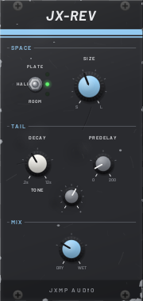
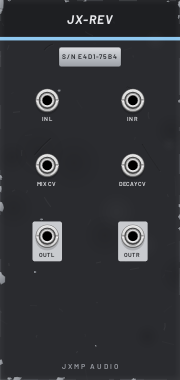

# JX-REV — Reverb

12 HP · JXMP Audio · [all modules](README.md)

Stereo reverb with three spaces: plate, hall and room. Size, decay 0.2–12 s, predelay, tone and mix.

 

## Front panel

| Control | What it does |
|---|---|
| PLATE / HALL / ROOM | PLATE dense and bright, HALL big and smooth, ROOM small and close. |
| SIZE | How big the space is. |
| DECAY | How long the tail lasts, 0.2–12 s. |
| PREDELAY | A gap of 0–200 ms before the reverb: keeps the dry sound clear. |
| TONE | Darker to brighter tail. |
| MIX | Dry to wet. As a console send / return use 100 %. |

## Sockets (back, `Tab` turns the rack)

| Socket | What it does |
|---|---|
| IN L | Left (or mono) input. |
| IN R | Right input; unpatched, the left one is used. |
| MIX CV, DECAY CV | 0–10 V adds to the knob. |
| OUT L, OUT R | Dry and reverb mixed by MIX, soft-limited at ±10 V. |

## How to use it

- Shared reverb on the console: SEND A → IN L, OUT L/R → RET A L/R, MIX 100 %.
- Insert on one sound: in its chain, MIX 20–35 %.
- Huge pad: HALL, SIZE high, DECAY 8 s, PREDELAY 60 ms, after JX-CHR.
