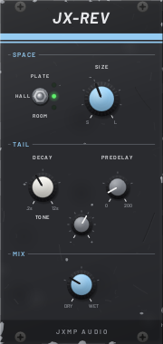
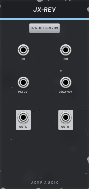
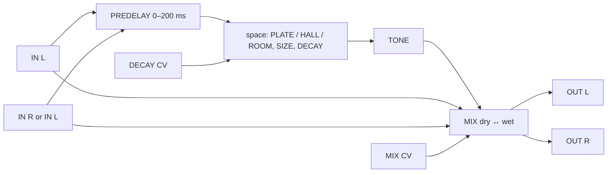

# JX-REV — Reverb

A stereo reverb with three spaces (plate, hall, room), size, decay 0.2–12 s, predelay, tone and mix.

12 HP · Effect · Stereo · [all modules](README.md)

 

## What it does

A reverb puts a sound in a space: the reflections of a room, a hall or a metal plate. Short and quiet it makes a dry
synth sound real; long and loud it turns a pad into an ambient wash.

## How it works

- IN R takes IN L when nothing is plugged into it (mono in, stereo out).
- DECAY is the time the tail takes to fade by 60 dB, 0.2–12 s.
- The outputs are soft-limited at ±10 V, so a long tail never clips hard.

## Quick start

1. A sound into **IN L**, **OUT L** and **OUT R** to two console channels (or a stereo destination).
2. ROOM, DECAY about 1 s, MIX 25 %.

## Front panel

| Control | Range | What it does |
|---|---|---|
| PLATE / HALL / ROOM | HALL default | PLATE dense and bright, HALL big and smooth, ROOM small and close. |
| SIZE | 25 … 200 % (100) | How big the space is. |
| DECAY | 0.2 … 12 s | How long the tail lasts. |
| PREDELAY | 0 … 200 ms (20) | A gap before the reverb: keeps the dry sound clear. |
| TONE | 0 … 100 % (60) | Darker to brighter tail. |
| MIX | 0 … 100 % (30) | Dry to wet; 100 % as a console send / return. |

## Back panel (sockets)

`Tab` or `F2` turns the rack round.

| Socket | Signal | What it does |
|---|---|---|
| IN L | Audio | Left (or mono) input. |
| IN R | Audio | Right input; empty = IN L. |
| MIX CV | CV 0–10 V | Adds to MIX. |
| DECAY CV | CV 0–10 V | Adds to DECAY. |
| OUT L, OUT R | Audio | Dry and reverb mixed by MIX. |

## Everything it can do

- Three algorithms with size, decay, predelay and tone.
- Mono or stereo input.
- CV on MIX and DECAY (e.g. more reverb at the end of a phrase).

## Patch ideas

- **Shared reverb on the console:** [JX-CONSOLE](jx-console.md) SEND B → IN L, OUT L / R → RET B L / R, MIX 100 %.
- **Insert on one sound:** in its chain, MIX 20–35 %.
- **Huge pad:** HALL, SIZE high, DECAY 8 s, PREDELAY 60 ms, after [JX-CHR](jx-chr.md).
- **Reverb swell:** an envelope into MIX CV, so the tail opens up on long notes.

## Good to know

- The DECAY shown is the target; the measured tail is about 12 % shorter (3 s shows as about 2.6 s).

## See also

[JX-CHR](jx-chr.md) · [JX-DLY](jx-dly.md) · [JX-CONSOLE](jx-console.md)
