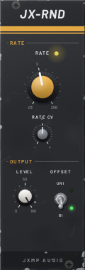
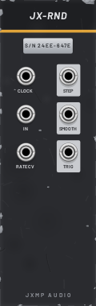

# JX-RND — Random

8 HP · JXMP Audio · [all modules](README.md)

Random voltages: stepped (sample & hold) and smooth, from internal noise or from the IN socket, with its own rate or a clock.

 

## Front panel

| Control | What it does |
|---|---|
| RATE | Internal rate, 0.03–256 Hz (same law as JX-LFO). Ignored while CLOCK is patched. |
| RATE CV | How much the RATE CV socket moves the rate. |
| LEVEL | Output level. |
| OFFSET  UNI / BI | BI: ±5 V. UNI: 0–10 V. |

## Sockets (back, `Tab` turns the rack)

| Socket | What it does |
|---|---|
| CLOCK | A new value on every edge (replaces RATE). |
| IN | Signal to sample instead of noise (sample & hold). |
| RATE CV | Rate CV in octaves per volt. |
| STEP | Jumps to a new value on every tick and holds it. |
| SMOOTH | Glides from value to value (over the measured clock period when clocked). |
| TRIG | A trigger on every new value. |

## How to use it

- Random melody: STEP → JX-QNT → JX-OSC, TRIG → JX-ENV.
- Slow drift: SMOOTH at a low rate into a filter cutoff or the pan of a console channel (via the Mixer view).
