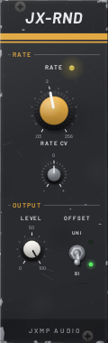
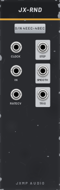
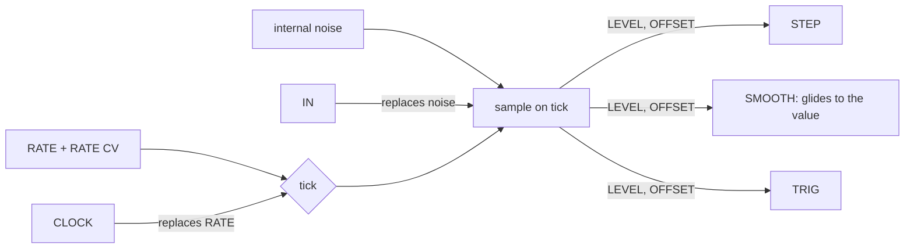

# JX-RND — Random

Random voltages: stepped (sample & hold) and smooth, from internal noise or from the IN socket, at its own rate or on a
clock.

8 HP · Envelope / modulation · Mono · [all modules](README.md)

 

## What it does

JX-RND makes unpredictable but controllable movement: a new random value on every tick (for random notes), or a
voltage that wanders smoothly between values (for slow drift). With a signal in IN it becomes a classic sample & hold.

## How it works

- A tick comes from RATE (0.03–256 Hz, 2 Hz default) or from every edge at CLOCK.
- On each tick the module samples noise (or IN) and holds it on STEP; SMOOTH glides to the new value over the time to
  the next tick (when clocked, over the measured clock period).
- LEVEL scales the result, OFFSET gives ±5 V (BI) or 0–10 V (UNI).

## Quick start

1. **STEP** → [JX-QNT](jx-qnt.md) → [JX-OSC](jx-osc.md) V/OCT.
2. **TRIG** → [JX-ENV](jx-env.md) GATE: random notes in a scale.

## Front panel

| Control | Range | What it does |
|---|---|---|
| RATE | 0.03 … 256 Hz (2 Hz) | Internal rate; ignored while CLOCK is patched. |
| RATE CV | −100 … +100 % | How much RATE CV moves the rate. |
| LEVEL | 0 … 100 % (100) | Output level. |
| OFFSET (UNI / BI) | BI default | BI ±5 V, UNI 0–10 V. |

## Back panel (sockets)

`Tab` or `F2` turns the rack round.

| Socket | Signal | What it does |
|---|---|---|
| CLOCK | Clock | A new value on every edge. |
| IN | Any | Sampled instead of noise. |
| RATE CV | CV | Rate in octaves per volt. |
| STEP | CV | Stepped random, held until the next tick. |
| SMOOTH | CV | Glides from value to value. |
| TRIG | Trigger | On every new value. |

## Everything it can do

- Stepped and smooth random at the same time from one source.
- Sample & hold of any signal (an LFO sampled by a clock gives stepped patterns).
- Tempo-synced through CLOCK.

## Patch ideas

- **Random melody:** STEP → JX-QNT → JX-OSC, TRIG → JX-ENV.
- **Slow drift:** SMOOTH at 0.1 Hz into a filter cutoff.
- **Stepped LFO:** a [JX-LFO](jx-lfo.md) TRI into IN, a clock into CLOCK.
- **Random accents:** STEP (UNI) into [JX-DRM](jx-drm.md) ACCENT.

## See also

[JX-NSE](jx-nse.md) · [JX-QNT](jx-qnt.md) · [JX-LFO](jx-lfo.md) · [JX-SLW](jx-slw.md)
