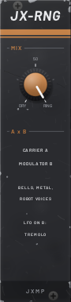
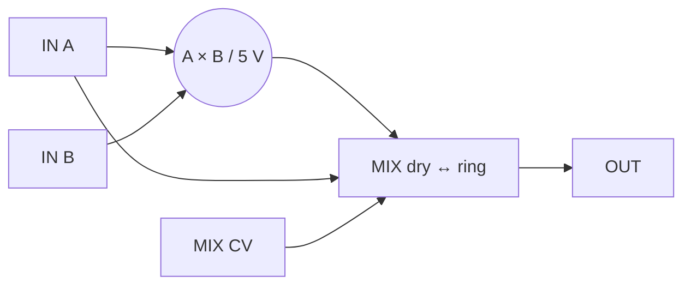

# JX-RNG — Ring

A ring modulator: multiplies A by B for bells, metal and robot voices (with an LFO on B: tremolo), with dry / wet mix.

6 HP · Filter / shaper · Polyphonic · [all modules](README.md)

 

## What it does

Multiplying two signals gives their sum and difference frequencies instead of the originals: two tones a non-whole
ratio apart turn into an inharmonic, bell-like or metallic sound. With a slow signal on B it is a tremolo.

## How it works

- 5 V × 5 V gives 5 V, so ±5 V signals stay at ±5 V.
- MIX goes from A alone to A × B.

## Quick start

1. Two [JX-OSC](jx-osc.md) SIN outputs into **IN A** and **IN B**, at different pitches.
2. **OUT** → [JX-AMP](jx-amp.md) with a short envelope: a bell.

## Front panel

| Control | Range | What it does |
|---|---|---|
| MIX | 0 … 100 % (100) | From A alone (dry) to A × B (ring). |

## Back panel (sockets)

`Tab` or `F2` turns the rack round.

| Socket | Signal | What it does |
|---|---|---|
| IN A | Audio, poly | Carrier. |
| IN B | Audio / CV | Modulator. |
| MIX CV | CV 0–10 V | Adds to MIX. |
| OUT | Audio | A × B mixed with A by MIX. |

## Patch ideas

- **Bell:** A and B a non-whole ratio apart (e.g. an octave and a tritone), then a short envelope.
- **Tremolo:** a [JX-LFO](jx-lfo.md) SIN (UNI) into B, MIX 50 %.
- **Robot voice:** a sample from [JX-SMPL](jx-smpl.md) into A, a 100 Hz sine into B.

## See also

[JX-FLD](jx-fld.md) · [JX-OSC](jx-osc.md) · [JX-AMP](jx-amp.md)
