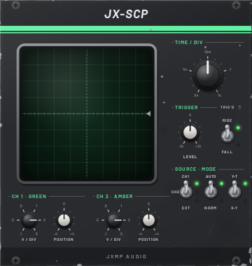
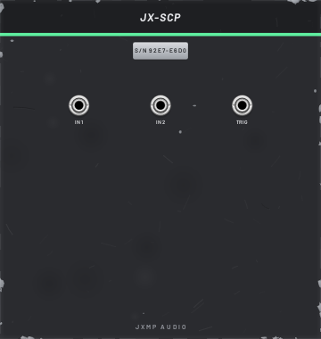

# JX-SCP — Scope

24 HP · JXMP Audio · [all modules](README.md)

Two-channel oscilloscope with a square green tube. It behaves like a small digital scope: the trigger point is always in the centre of the screen, only whole pictures are drawn, and TIME / DIV redraws at once.

 

## Front panel

| Control | What it does |
|---|---|
| TIME / DIV | Time of one square across, 0.1 ms – 1 s. Short for audio, long for LFOs and envelopes. |
| TRIGGER LEVEL | The voltage the wave must cross to start a picture (the dashed line). Outside the wave nothing triggers. |
| RISE / FALL | Trigger when the wave crosses the level going up or going down. |
| TRIG'D | Lights on every trigger. |
| SOURCE  CH1 / CH2 / EXT | Which signal triggers: the green input, the amber input, or TRIG on the back. |
| AUTO / NORM | AUTO always shows something and locks to the trigger when one comes. NORM draws only on a trigger and otherwise keeps the last picture. |
| Y-T / X-Y | Y-T: waves over time. X-Y: CH 1 across, CH 2 up (Lissajous figures, stereo width). |
| V / DIV (CH 1, CH 2) | Volts per square up, 0.1–5 V. Smaller draws the wave taller. |
| POSITION (CH 1, CH 2) | Moves the trace up or down. |

## Sockets (back, `Tab` turns the rack)

| Socket | What it does |
|---|---|
| IN 1 | Channel 1, green (X in X-Y). Polyphonic: the first voice is drawn. |
| IN 2 | Channel 2, amber (Y in X-Y). |
| TRIG | External trigger, used when SOURCE is EXT. |

## How to use it

- Look at a sound: the oscillator into IN 1, TIME / DIV 1–2 ms, SOURCE CH1, AUTO.
- Look at an envelope: IN 1 = JX-ENV ENV, the gate into TRIG, SOURCE EXT, NORM, TIME / DIV 0.1–0.5 s.
- Compare two signals: the second one into IN 2 (e.g. before and after JX-FLD).
