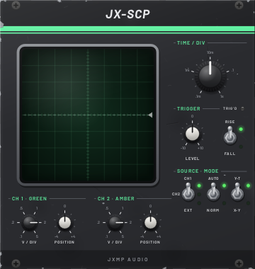
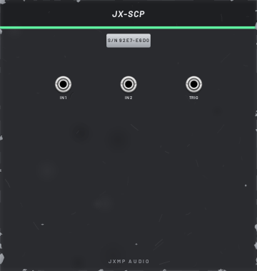
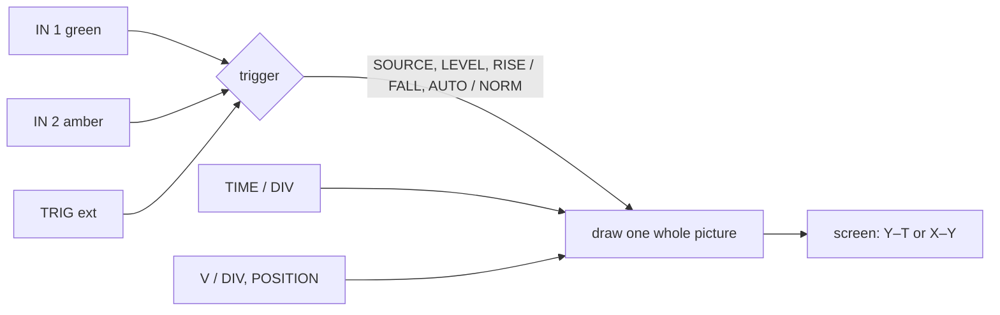

# JX-SCP — Scope

A two-channel oscilloscope with a green tube: Y–T and X–Y, trigger level and slope, three trigger sources.

24 HP · Utility · Shows the first voice · [all modules](README.md)

 

## What it does

A scope draws a voltage over time, so you can see what you hear: the shape of a wave, how an envelope rises and falls,
whether an LFO is bipolar, where a signal clips. It does not change the sound.

## How it works

- It behaves like a small digital scope: the trigger point is in the centre of the screen, only whole pictures are
  drawn, and a new TIME / DIV is used at once.
- **AUTO** always draws and locks to the trigger when one comes; **NORM** draws only on a trigger and keeps the last
  picture otherwise.
- **X–Y** puts IN 1 across and IN 2 up (Lissajous figures, stereo width).
- A polyphonic cable shows its first voice.

## Quick start

1. An oscillator into **IN 1**.
2. TIME / DIV 1–2 ms, SOURCE CH1, AUTO: a steady wave.

## Front panel

| Control | Range | What it does |
|---|---|---|
| TIME / DIV | 0.1 ms … 1 s (10 ms) | Time of one square across. |
| TRIGGER LEVEL | −10 … +10 V (0) | The voltage the wave must cross to start a picture (dashed line). |
| RISE / FALL | RISE default | Trigger going up or going down. |
| TRIG'D | light | Lights on every trigger. |
| SOURCE (CH1 / CH2 / EXT) | CH1 default | Which signal triggers. |
| AUTO / NORM | AUTO default | See above. |
| Y-T / X-Y | Y-T default | Waves over time, or CH 1 against CH 2. |
| V / DIV (CH 1, CH 2) | 0.1 … 5 V (2 V) | Volts per square up; smaller draws the wave taller. |
| POSITION (CH 1, CH 2) | ±4 squares | Moves the trace up or down. |

## Back panel (sockets)

`Tab` or `F2` turns the rack round.

| Socket | Signal | What it does |
|---|---|---|
| IN 1 | Any | Channel 1, green (X in X–Y). |
| IN 2 | Any | Channel 2, amber (Y in X–Y). |
| TRIG | Trigger | External trigger, used when SOURCE is EXT. |

## Everything it can do

- Two traces in two colours with separate scale and position.
- Internal or external trigger, normal or auto mode.
- X–Y mode for phase and stereo pictures.

## Patch ideas

- **See a sound:** the oscillator into IN 1, TIME / DIV 1–2 ms, AUTO.
- **See an envelope:** IN 1 = [JX-ENV](jx-env.md) ENV, the gate into TRIG, SOURCE EXT, NORM, TIME / DIV 0.1–0.5 s.
- **Before and after:** the dry signal into IN 1, the processed one (e.g. [JX-FLD](jx-fld.md)) into IN 2.
- **Stereo picture:** a reverb's OUT L and OUT R into IN 1 and IN 2, X–Y: a line = mono, a cloud = wide.

## See also

[JX-OSC](jx-osc.md) · [JX-ENV](jx-env.md) · [JX-LFO](jx-lfo.md)
