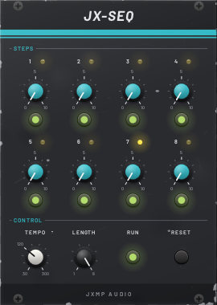
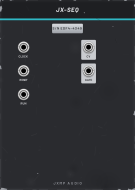

# JX-SEQ — SEQ

18 HP · JXMP Audio · [all modules](README.md)

Eight-step sequencer with a CV knob and a gate button per step, its own tempo or an external clock.

 

## Front panel

| Control | What it does |
|---|---|
| Step 1–8 knob | CV of the step, 0–10 V. The LED above shows the playing step. |
| Step 1–8 button | Gate on or off for the step (off = a rest, the CV still changes). |
| TEMPO | Internal clock, 30–300 BPM, one step per beat. Ignored while CLOCK is patched. |
| LENGTH | How many steps before it starts again, 1–8. |
| RUN | Starts and stops the sequence. |
| RESET | Back to step 1. |

## Sockets (back, `Tab` turns the rack)

| Socket | What it does |
|---|---|
| CLOCK | External clock: every rising edge moves one step (replaces TEMPO). |
| RESET | A trigger goes back to step 1; the next clock plays step 1. |
| RUN | Runs while this is above 1 V (replaces the RUN button). |
| CV | CV of the current step, 0–10 V. |
| GATE | High while the clock is high, if the step's gate is on. |

## How to use it

- Melody: CV → JX-QNT → JX-OSC V/OCT, GATE → JX-ENV GATE.
- In time with everything else: JX-CLK x2 or x4 into CLOCK, JX-CLK RESET into RESET.
- The CV knobs span 10 octaves: small turns are big steps. JX-QNT keeps them on the scale; JX-ATT can scale them down.
