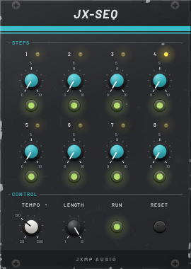
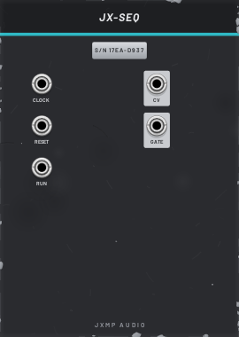
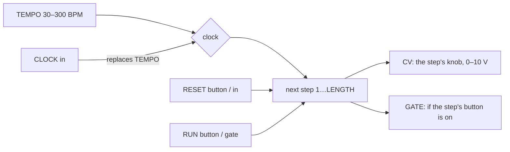

# JX-SEQ — SEQ

An eight-step sequencer with a CV knob and a gate button per step, its own tempo or an external clock.

18 HP · Sequencing / time · Mono · [all modules](README.md)

 

## What it does

JX-SEQ plays a short repeating pattern: on every clock it moves to the next step and outputs that step's voltage and
gate. With a quantizer the voltages become notes, so it plays a melody or a bass line; without one it can step
through filter settings or anything else.

## How it works

- Without a CLOCK cable the internal clock plays one step per beat at TEMPO.
- On RESET the sequence goes back to step 1; the next clock plays step 1 (so it starts in time).
- The gate is high while the clock is high on steps whose button is on; off steps are rests (CV still changes).
- The LED above each step shows the one playing.

## Quick start

1. **CV** → [JX-QNT](jx-qnt.md) V/OCT in → [JX-OSC](jx-osc.md) V/OCT.
2. **GATE** → [JX-ENV](jx-env.md) GATE → [JX-AMP](jx-amp.md) CV.
3. Turn the step knobs: each one picks a note of the scale set on JX-QNT.

## Front panel

| Control | Range | What it does |
|---|---|---|
| Step 1–8 knob | 0 … 10 V | CV of the step. |
| Step 1–8 button | on / off | Gate of the step (off = rest). |
| TEMPO | 30 … 300 BPM (120) | Internal clock, one step per beat; ignored while CLOCK is patched. |
| LENGTH | 1 … 8 | Steps before it starts again. |
| RUN | running / stopped | Starts and stops the sequence. |
| RESET | button | Back to step 1. |

## Back panel (sockets)

`Tab` or `F2` turns the rack round.

| Socket | Signal | What it does |
|---|---|---|
| CLOCK | Clock | Every rising edge moves one step (replaces TEMPO). |
| RESET | Trigger | Back to step 1; the next clock plays step 1. |
| RUN | Gate | Runs while above 1 V (replaces the RUN button). |
| CV | CV 0–10 V | The current step's voltage. |
| GATE | Gate | High while the clock is high, on steps with the gate on. |

## Everything it can do

- 1–8 steps with rests, own tempo or any external clock (faster or slower via [JX-CLK](jx-clk.md) ratios).
- Start / stop and reset from buttons or from other modules.
- Not only pitch: the CV can drive a filter, a delay time, a mix level.

## Patch ideas

- **Bass line:** JX-CLK x2 into CLOCK, CV → JX-QNT (Minor) → JX-OSC with SUB, GATE → a short JX-ENV.
- **Two sequencers, one groove:** both from the same JX-CLK, one with LENGTH 8, one with 7 (shifting pattern).
- **Filter steps:** CV straight into [JX-FLT](jx-flt.md) FREQ CV while a keyboard plays the notes.
- **In time with the song:** JX-CLK RESET into RESET so the pattern starts on bar 1.

## Good to know

- The knobs span 10 V = 10 octaves, so small turns are big steps. JX-QNT keeps them on a scale; [JX-ATT](jx-att.md)
  can scale them down (gain 0.2 = two octaves).
- For whole songs with many notes use the [Editor](jx-edit.md) instead.

## See also

[JX-QNT](jx-qnt.md) · [JX-CLK](jx-clk.md) · [JX-EUC](jx-euc.md) · [JX-EDIT](jx-edit.md)
